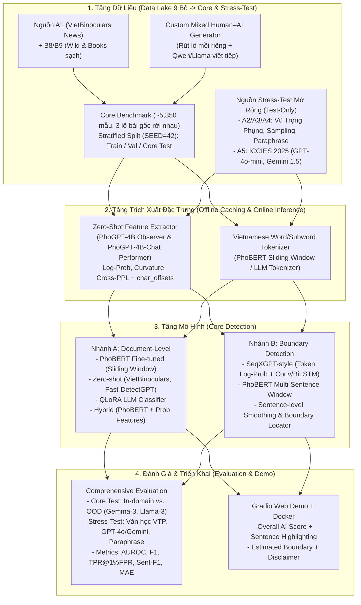

# Kế Hoạch Chi Tiết Thực Hiện Dự Án (Project Master Plan)

**Đề tài:** Phát hiện Văn bản Tiếng Việt do AI sinh ra và Văn bản Lai Người–AI (Detecting AI-Generated and Mixed Human–AI Vietnamese Text)  
**Quy mô nhóm:** 6 thành viên  
**Tài liệu nền tảng:**
- Kế hoạch tổng thể & Nguồn dữ liệu: `General Plan.txt`, `topic-registration-form.md`, `dataset_sources.txt` & `dataset_download.py`
- Bài báo nền tảng 1 (**Binoculars** - ICML 2024): *Spotting LLMs With Binoculars: Zero-Shot Detection of Machine-Generated Text* (`2401.12070v3.pdf`)
- Bài báo nền tảng 2 (**VietBinoculars** - 2026): *VietBinoculars: A Zero-Shot Approach for Detecting Vietnamese LLM-Generated Text* (`2509.26189v2.pdf`)
- Bài báo nền tảng 3 (**ViDetect** - 2024): *Vietnamese AI Generated Text Detection* (`2405.03206v1.pdf`)

---

## 1. Mục tiêu & Ý tưởng Cốt lõi của Dự án

### 1.1. Khoảng trống nghiên cứu (Research Gap) từ các bài báo
1. **Hạn chế về cấu trúc văn bản:** Cả *VietBinoculars* và *ViDetect* chỉ mới giải quyết bài toán phân loại nhị phân toàn văn bản (**Document-level**: 100% Người viết hoặc 100% AI viết). Trong thực tế, người dùng thường tự viết phần mở đầu rồi dùng AI viết tiếp, hoặc dùng AI chỉnh sửa một số đoạn (**Mixed Human–AI text**).
2. **Hạn chế của tập dữ liệu VietBinoculars gốc:** Tập dữ liệu *VietBinoculars* luôn lấy đúng **50 tokens đầu tiên** của bài báo người viết làm prompt cho LLM (`Sailor2-8B`, `Gemma-3-12B`) sinh tiếp, rồi cắt bỏ 50 tokens đó khi đánh giá. Do đó, ranh giới chuyển giao bị cố định và rất ngắn.
3. **Điểm yếu đơn lẻ của từng hướng tiếp cận:**
   - **Zero-shot thống kê (*VietBinoculars*, *Fast-DetectGPT*):** Khái quát hóa tốt sang các LLM mới và giải quyết được bài toán "Capybara" nhờ cặp `PhoGPT-4B` và `PhoGPT-4B-Chat`, nhưng hiệu năng giảm trên văn bản ngắn (< 300 tokens) hoặc khi sinh với nhiệt độ cao / viết lại nhiều lần (*double paraphrasing*).
   - **Supervised Fine-tuning (*PhoBERT* trong *ViDetect*, *QLoRA*):** Nắm bắt ngữ nghĩa và văn phong tiếng Việt rất tốt ở độ dài ngắn–trung bình, nhưng dễ bị quá khớp (overfit) vào các LLM có trong tập huấn luyện.

### 1.2. Giải pháp của Nhóm (Đóng góp chính)
Xây dựng một hệ thống **Phát hiện văn bản Tiếng Việt lai (Mixed Human–AI) hai cấp độ** kèm **Web Demo đóng gói bằng Docker**:
1. **Dữ liệu Mixed Human–AI tự xây dựng:** Kết hợp dữ liệu gốc từ *VietBinoculars* (Báo chí + Văn học Vũ Trọng Phụng) với dữ liệu sinh mới từ các LLM mở (`Qwen2.5`, `Llama-3`) có **điểm cắt ngẫu nhiên theo câu (varying, known boundaries)** và gán nhãn tới từng câu.
2. **Cấp độ 1 – Document-level Detection:** So sánh toàn diện giữa *Supervised* (`PhoBERT`, `QLoRA LLM`), *Zero-shot* (`VietBinoculars`, `Fast-DetectGPT`) và thiết kế mô hình **Hybrid** kết hợp đặc trưng xác suất (probability features) với biểu diễn ngữ nghĩa của `PhoBERT`.
3. **Cấp độ 2 – Boundary & Sentence-level Detection:** Xác định chính xác câu nào do AI viết và vị trí câu bắt đầu chuyển từ Người sang AI, so sánh giữa hướng **Token log-probability (theo *SeqXGPT*)** và hướng **Token/Sentence Classification với `PhoBERT`**, kết hợp thuật toán **làm mượt trên chuỗi câu (sentence smoothing)**.
4. **Đóng gói & Triển khai (Gradio + Docker):** Ứng dụng Web cho phép dán văn bản tiếng Việt, báo điểm nghi ngờ tổng thể, tô màu (highlight) từng câu theo mức độ nghi ngờ, chỉ ra vị trí ranh giới Người–AI, từ chối văn bản quá ngắn và hiển thị cảnh báo đạo đức. Toàn bộ chạy chỉ với 1 câu lệnh Docker (tự tải model weights khi khởi động).

---

## 2. Kiến trúc Tổng thể Hệ thống



---

## 3.0. Kiến Trúc Dữ Liệu 2 Tầng Từ 9 Bộ Nguồn (`dataset_sources.txt`)

Nhóm đã tải đầy đủ **9 bộ dữ liệu công khai (~7.8 GB)** về `datasets/` qua `dataset_download.py` (`A1–A5` có cặp Người–AI và `B6–B9` chỉ có văn bản Người). Thay vì đổ cả 7.8 GB vào huấn luyện (vượt quá khả năng trích xuất của cặp `PhoGPT-4B`), kho dữ liệu được khai thác như một **Data Lake** chia làm **2 tầng rõ rệt**:

### Tầng 1: Tập Core Benchmark (~5,350 mẫu độc lập — Dùng cho Train / Val / Core Test)
Để đảm bảo độ đa dạng tối đa và không gây nhiễu nhãn phần mở đầu, TV1 rút **3 lô bài gốc hoàn toàn rời nhau (Disjoint Source Articles — không dùng trùng một bài gốc cho nhiều nhãn)** từ `A1 (vietnamese-news)` kết hợp một tỷ lệ nhỏ (~15%) từ `B8 (Wikipedia)` và `B9 (Books sạch tiếng Việt)`:

| Lô dữ liệu | Số mẫu | Nguồn rút & Phân bổ Generator | Phân chia Train / Val / Core Test |
|---|---|---|---|
| **Lô 1: `Human`** | ~1,500 | Bài gốc Người viết từ `A1` (~1,200) + `B8 Wiki` / `B9 Books` (~300); giữ nguyên 100% | Chia đều vào `Train` / `Val` / `Core Test` |
| **Lô 2: `AI thuần`** | ~1,500 | Rút từ các dòng **khác Lô 1**: `Sailor2-8B` (~900, từ A1 train/val) + `Qwen2.5-7B` tự sinh (~300) + `Gemma-3-12B` (~300, từ A1 test) | `Sailor2` & `Qwen2.5`: In-domain (`Train`/`Val`/`Test`)<br>`Gemma-3-12B`: **OOD (`chỉ đặt ở Core Test`)** |
| **Lô 3: `Mixed`** | ~2,350 | Rút ~2,350 bài Người **khác hẳn Lô 1 & Lô 2** làm mồi $\rightarrow$ cắt ngẫu nhiên câu $k \in [20\%, 80\%]$ $\rightarrow$ LLM viết tiếp: `Qwen2.5-7B` (~1,750) + `Llama-3.1-8B` (~600) | `Qwen2.5`: In-domain (`Train`/`Val`/`Test`)<br>`Llama-3.1-8B`: **OOD (`chỉ đặt ở Core Test`)** |
| **Tổng Core** | **~5,350** | **`~3,500 Train` \| `~750 Val` \| `~1,100 Core Test`** (`~500 In-domain` + `~600 OOD Generator`) | `source_article_id` độc lập 100%, cố định `SEED = 42` |

* **Cách tận dụng sẵn 3 file tách biệt của `A1 (vietnamese-news)` để không bao giờ lộ bài gốc:**
  - `A1/train.parquet` (`41,345` cặp `Sailor2-8B`) $\rightarrow$ Rút mẫu cho **`TRAIN (~3,500 mẫu)`**. *(Quy mô ~3,500 bài $\approx$ 1.8 triệu tokens / ~45,000 câu giúp TV1 sinh `vLLM` trong ~2 giờ và TV2 trích `PhoGPT-4B` gọn trong ~3–4 giờ GPU mà vẫn đủ hội tụ `AUROC > 0.95`. Riêng nhánh nhẹ `PhoBERT Doc` có thể làm thêm thí nghiệm scale-up lên 20k–50k mẫu từ `A1 + A5` nếu còn thời gian, nhưng bảng so sánh chính giữa các model bắt buộc dùng chung tập ~3,500 mẫu này).*
  - `A1/validation.parquet` (`19,129` cặp `Sailor2-8B`) $\rightarrow$ Chia đôi theo dòng không chồng lấn: một phần đưa vào **`VALID (~750 mẫu)`** (để chọn ngưỡng `TPR@1%FPR`, early stopping, tham số smoothing), một phần dành riêng cho **`CORE TEST – Nhánh In-Domain (~500 mẫu)`**.
  - `A1/test.parquet` (`7,222` cặp `Gemma-3-12B`) $\rightarrow$ Đưa vào **`CORE TEST – Nhánh OOD Generator (~600 mẫu)`** (lấy `Gemma-3-12B` và lấy bài gốc Người ở đây mớm cho `Llama-3.1-8B` sinh Mixed OOD).

### Tầng 2: Ba Bộ Stress-Test Mở Rộng (`Test-Only` ở Tuần 5, không đưa vào Train/Val)
Tận dụng các bộ dữ liệu chuyên biệt còn lại để kiểm thử giới hạn thực tế của hệ thống mà không tốn thêm giờ huấn luyện:
1. **Stress-Test 1 – OOD Miền Văn Học (`A2: vu-trong-phung` — 738 mẫu):** Cách ly **100% cả 4 bộ họ Vũ Trọng Phụng (`A2, A3, A4, B6`) sang TEST** (0% vào Train/Val) vì cả 4 bộ đều xoay quanh đúng **369 đoạn văn gốc** của Vũ Trọng Phụng.
2. **Stress-Test 2 – Commercial LLMs (`A5: iccies-2025-news-human-ai` — rút 1,000 mẫu cân bằng):** Đánh giá khả năng bắt văn bản của các LLM thương mại đóng (**GPT-4o-mini, Gemini 1.5 Flash, DeepSeek**) ở cấp độ toàn bài *(lọc khử trùng lặp 80 ký tự đầu so với tập Train/Val của A1)*.
3. **Stress-Test 3 – Độ bền trước Paraphrase & Sampling (`A4: text-rewriting` & `A3: sampled-generations-vtp` — ~300–500 mẫu):** Vẽ đường cong suy giảm `AUROC` qua 4 mức độ lách kiểm duyệt trong `A4` (`AI_text` $\rightarrow$ `AI_paraphrase_1` $\rightarrow$ `AI_paraphrase_2` $\rightarrow$ `AI_humanized`, sau khi lọc bỏ các dòng lỗi lẫn tiếng Mã Lai) và theo nhiệt độ sinh trong `A3`.

---

## 3.1. Môi Trường Tính Toán & Phương Án Dự Phòng GPU

**Môi trường chính: Kaggle Notebooks (2 × T4, mỗi card khoảng 16GB)** kết hợp máy cá nhân của nhóm (ví dụ GPU Laptop 6GB VRAM cho test nhanh/debug). Mỗi tài khoản Kaggle có khoảng 30 giờ GPU/tuần và mỗi phiên tối đa khoảng 12 giờ; 6 thành viên dùng 6 tài khoản. Colab free hoặc GPU của lab/trường là môi trường phụ.

| Tác vụ | Ai chạy | Cách chạy trên Kaggle / Local |
|---|---|---|
| Sinh dữ liệu mixed & AI bổ sung (Qwen/Llama) | TV1 | Model ~7B ở 4-bit, chạy bằng **`vLLM`** (nhanh gấp 5–8 lần `generate` thường) + Assistant Prefill |
| Trích log-prob & curvature PhoGPT-4B (~5.35k Core + Stress-Test) | TV2 | Observer trên GPU 0, Performer trên GPU 1, fp16; **chạy 1 lần duy nhất**, lưu luôn đặc trưng Fast-DetectGPT + `char_offsets` ở kiểu `float16` |
| Fine-tune PhoBERT (Sliding Window) | TV3, TV5 | 1 T4 (hoặc GPU 6GB local), fp16, batch nhỏ + gradient accumulation |
| QLoRA | TV3 | LLM cỡ 1.5–3B, 4-bit trên 1 T4 |
| SeqXGPT-style, smoothing, Hybrid | TV3, TV4 | Chỉ đọc cache đặc trưng, nhẹ (chạy được trên CPU, GPU 6GB local hoặc 1 T4) |
| Demo | TV6 | Mặc định PhoBERT trên CPU; tùy chọn bật Lightweight Hybrid/SeqXGPT (`Qwen2.5-0.5B` CPU/GPU) |

**Quy tắc chung:**
1. **Chạy nặng một lần, chia sẻ kết quả:** cache đặc trưng (gom thành đúng 1 file `.pt`/`.parquet` cho mỗi split `train`/`val`/`test`, ép kiểu `float16` chỉ nặng ~80–120 MB tổng cộng — **tuyệt đối không tách lẻ thành 5,000 file nhỏ gây nghẽn I/O**) và checkpoint được đưa lên HF Hub + Kaggle Dataset để cả nhóm dùng lại.
2. **Lưu tiến độ định kỳ:** script sinh dữ liệu và trích đặc trưng ghi kết quả theo đợt khoảng 500 mẫu để chạy tiếp được khi phiên bị ngắt.
3. **Đo trước khi chốt:** Tuần 1, TV2 chạy thử cặp PhoGPT-4B trên 100 mẫu và TV1 sinh thử 20 mẫu để ước lượng thời gian thật và kiểm tra chất lượng tiếng Việt.
4. Nếu sinh dữ liệu quá chậm, giảm phần mixed ở Core từ ~2,350 xuống khoảng 1,200 mẫu (900 In-domain + 300 OOD).

**Phương án dự phòng (chỉ dùng nếu không có Kaggle hay GPU tương đương):**

| Thành phần | Thay bằng | Ảnh hưởng |
|---|---|---|
| Cặp PhoGPT-4B (Binoculars) | Qwen2.5-1.5B base và Qwen2.5-1.5B-Instruct (chung tokenizer, đúng yêu cầu của Binoculars) | Kém hơn VietBinoculars gốc; báo cáo phải ghi rõ |
| Fast-DetectGPT | Tính chung trên cặp Qwen2.5-0.5B/1.5B | Tương tự như trên |
| QLoRA | LLM 0.5–1.5B | Vẫn giữ được thí nghiệm |
| LLM sinh dữ liệu mixed | Qwen2.5-3B ở 4-bit (vừa GPU 6–8GB local) | Văn bản kém tự nhiên hơn một chút |
| Demo | PhoBERT (hoặc kèm `Qwen2.5-0.5B`) chạy CPU | Không ảnh hưởng |

Dù dùng phương án nào, các phần trong `General Plan.txt` vẫn được giữ nguyên; chỉ kích thước model thay đổi.

---

## 3.2. Quy Hoạch Lưu Trữ Dữ Liệu & Trọng Số (GitHub vs. Hugging Face vs. Kaggle)

Để tránh lỗi chặn file `> 100 MB` của GitHub, tránh hết băng thông Git LFS và tránh khóa link Google Drive lúc chấm bài, nhóm thống nhất lưu trữ theo 3 nơi:

| Loại dữ liệu / Mã nguồn | Nơi lưu trữ | Quy tắc bắt buộc |
|---|---|---|
| **Kho dữ liệu thô (`datasets/` — 7.8 GB)** | Chỉ lưu ở máy Local của TV1 | **Không đưa lên GitHub, không upload lại lên HF của nhóm.** Đã có sẵn trên HF gốc; ai cần bộ nào chạy `python dataset_download.py --only <tên>`. |
| **Mã nguồn, tài liệu & 1 file mẫu debug:**<br>`src/`, `app/`, `scripts/`, `dataset_download.py`, `dataset_sources.txt`, `Detailed_Project_Plan.md`, và **`data/sample_debug.jsonl` (~20 dòng, ~30 KB)** | **GitHub Repository** | File `sample_debug.jsonl` giúp mọi thành viên vừa `git clone` đều test được code & UI Gradio ngay lập tức mà không cần tải dữ liệu lớn. |
| **Dữ liệu chuẩn hóa, Cache & Weights của nhóm:**<br>• `processed/` (`train.jsonl`, `val.jsonl`, `test.jsonl`, `sample_500.jsonl`)<br>• `stress_test/` (3 bộ test mở rộng)<br>• `features_cache/` (các file `.pt`/`.parquet` kiểu `float16`)<br>• `weights/` (checkpoint tốt nhất của TV3, TV4, TV5) | **Hugging Face Organization của nhóm** *(Dataset Repo + Model Repo)* & đồng bộ sang **Kaggle Dataset** | Mount trực tiếp vào `/kaggle/input/...` khi train GPU (tốn 0 giây tải); lúc chạy `docker compose up`, script của TV6 tự tải weights từ HF Model Repo bằng `snapshot_download()`. |

---

## 3. Phân Công Chi Tiết Cho 6 Thành Viên (Work Breakdown Structure)

Để đảm bảo 6 người làm việc song song hiệu quả và không bị nghẽn cổ chai (bottleneck), dự án được chia thành **6 gói công việc (Work Packages - WP)** độc lập nhưng có giao diện dữ liệu (input/output schema) thống nhất.

---

### 👤 Thành viên 1: Data Engineer & Mixed-Text Pipeline Lead
**Trọng tâm:** Xây dựng toàn bộ nền tảng dữ liệu từ kho 9 bộ nguồn (`datasets/`) cho cả Tập Core (~5,350 mẫu) và 3 Tập Stress-Test, đảm bảo không rò rỉ dữ liệu (data leakage) và sạch nhiễu định dạng.

* **Công việc cụ thể:**
  1. **Lọc chất lượng & Khử nhiễu từ 9 bộ nguồn (`datasets/`):**
     - Khai thác `A1` (`vietnamese-news`), `B8` (`vietnamese-wikipedia-clean`), `B9` (`vietnamese-book-corpus` — lọc bỏ sách tiếng Anh/dịch lỗi) cho Tập Core; đồng thời chuẩn bị 3 bộ Stress-Test từ `A2, A3, A4` (họ *Vũ Trọng Phụng* — **cách ly 100% sang Test** vì cả 4 bộ `A2, A3, A4, B6` dùng chung đúng 369 đoạn gốc) và `A5` (`iccies-2025-news-human-ai`).
     - **Xử lý lỗi câu đầu/cuối bị cụt (Chống Shortcut Learning):** Ở các bộ họ VietBinoculars (`A1, A2, A3, A4`), do cắt bỏ 50 tokens prompt đầu nên câu đầu tiên của văn bản AI thường bị cụt lửng lơ (ví dụ bắt đầu ngay bằng dấu chấm `". Ông là..."` ở `A4`). **Bắt buộc cắt bỏ phần chữ lẻ đầu bài đến hết dấu kết thúc câu đầu tiên** và loại bỏ câu cuối chưa hoàn chỉnh; riêng `A4` lọc bỏ các dòng lỗi lẫn tiếng Mã Lai.
     - **Khử trùng lặp bài báo (Deduplication):** Giữa `A1`, `A5 (ICCIES)` và `B7 (Binhvq)` đều cào từ báo Việt Nam; chạy chuẩn hóa chữ thường + so khớp 80 ký tự đầu để loại bỏ mọi mẫu Stress-Test bị trùng với tập `Train/Val`.
  2. **Tách câu & Lấy mẫu Ngẫu nhiên Phân tầng có Khóa Seed (`SEED = 42`):**
     - Sử dụng `underthesea` hoặc `pyvi` / `VnCoreNLP` tách văn bản thành danh sách câu hoàn chỉnh $S = [s_1, \dots, s_N]$; chỉ giữ các bài sạch HTML có độ dài **từ `6` đến `25` câu** (`~150–650` từ).
     - **Không bốc random mù:** Rút **3 lô bài gốc hoàn toàn rời nhau** (`Lô 1: Human`, `Lô 2: AI thuần`, `Lô 3: Mồi Người riêng để sinh Mixed`) bằng **Stratified Random Sampling** cân bằng theo chủ đề (`topic` trong `A1`) và phân bố độ dài, khóa cứng `SEED = 42` để tái lập 100%.
  3. **Sinh dữ liệu Lai (Mixed Human–AI) từ Lô 3 & Khử văn mẫu Chatbot:**
     - Với mỗi bài gốc của Người thuộc **Lô 3** ($N \ge 6$ câu): chọn ngẫu nhiên vị trí cắt $k \in [\lfloor 0.2N \rfloor, \lfloor 0.8N \rfloor]$ theo phân phối đều, giữ $k$ câu đầu $[s_1, \dots, s_k]$ làm prefix.
     - Đưa prefix vào `Qwen2.5-7B` (cho In-domain `Train/Val/Test`, đồng thời sinh thêm ~300 mẫu `AI thuần` cho Lô 2 rồi cắt bỏ câu mồi) và `Llama-3.1-8B` (chỉ đặt ở `Core Test OOD`; có thể thay bằng `SeaLLMs-v3-7B` / `Vistral-7B` nếu Llama tiếng Việt kém ở bước thử 20 mẫu).
     - **Chống lọt câu dẫn nhập của Instruct LLM:** Chạy bằng **`vLLM`** với **Base model** hoặc **Assistant Prefill**, kết hợp regex hậu xử lý để loại bỏ tuyệt đối các câu dẫn kiểu *"Dưới đây là phần viết tiếp..."* hoặc lặp lại câu $s_k$. Kiểm soát `max_new_tokens` tương ứng phần còn lại của bài gốc để tránh lệch độ dài.
     - Gán nhãn câu: $y_i = 0$ ($i \le k$) và $y_i = 1$ ($i > k$); lưu chỉ số 0-based `boundary_sentence_idx = k`.
  4. **Đóng gói & Phân phối dữ liệu theo chuẩn Mục 3.2:**
     - Đưa `data/sample_debug.jsonl` (~20 dòng) lên GitHub; đẩy bộ đầy đủ `processed/` (`train.jsonl`, `val.jsonl`, `test.jsonl`, `sample_500.jsonl`) và `stress_test/` lên **Hugging Face Dataset Repo của nhóm** + đồng bộ sang **Kaggle Dataset**.

* **Đầu ra bàn giao (Deliverables):**
  - Bộ dữ liệu trên HF Dataset Repo / Kaggle Dataset + file mẫu `data/sample_debug.jsonl` trên GitHub.
  - Script tiền xử lý, sinh dữ liệu (`SEED = 42`) và bảng thống kê mô tả phân phối dữ liệu cho báo cáo.

---

### 👤 Thành viên 2: Zero-Shot Statistical Models & Feature Extraction Lead
**Trọng tâm:** Hiện thực hóa các phương pháp Zero-shot (*VietBinoculars*, *Fast-DetectGPT*) và trích xuất sẵn đặc trưng xác suất mức token/câu (kèm căn chỉnh vị trí ký tự) cho cả nhóm trong đúng 1 lần chạy GPU.

* **Công việc cụ thể:**
  1. **Cài đặt VietBinoculars (theo sát bài báo `2509.26189v2.pdf`):**
     - Tải cặp mô hình `vinai/PhoGPT-4B` (Observer $M_1$) và `vinai/PhoGPT-4B-Chat` (Performer $M_2$) với độ dài tối đa 768 tokens. **Lưu ý GPU:** trên Kaggle 2 × T4, đặt mỗi model lên một GPU ở fp16. Nếu chỉ có một GPU 16GB thì nạp 8-bit, chạy batch nhỏ.
     - Tính **Log-Perplexity** $\log \text{PPL}_{M_2}(s)$ và **Log Cross-Perplexity** $\log \text{X-PPL}_{M_1, M_2}(s)$ theo công thức (2), (4), (5) trong bài báo:
       $$B_{M_1, M_2}(s) = \frac{\log \text{PPL}_{M_2}(s)}{\log \text{X-PPL}_{M_1, M_2}(s)}$$
  2. **Cài đặt Fast-DetectGPT & Các Baseline thống kê (Tính ngay trong cùng lượt forward):**
     - Tính **Analytical Conditional Probability Curvature** (Fast-DetectGPT) trực tiếp từ phân phối xác suất trên toàn bộ từ điển vocab $V$ tại mỗi vị trí token $t$:
       $$\tilde{\mu}_t = \sum_{v \in V} p_{M_1}(v \mid x_{<t}) \log p_{M_2}(v \mid x_{<t}), \qquad \tilde{\sigma}_t^2 = \sum_{v \in V} p_{M_1}(v \mid x_{<t}) \big(\log p_{M_2}(v \mid x_{<t}) - \tilde{\mu}_t\big)^2$$
       *(Cực kỳ quan trọng: phải tính và rút gọn $\tilde{\mu}_t, \tilde{\sigma}_t^2$ ngay lúc tensor `logits` còn trên GPU ở lần chạy đầu tiên; nếu chỉ lưu `log_prob` của token thật rồi xóa `logits` thì sẽ không thể tính lại Fast-DetectGPT từ cache!).*
     - Tính thêm các chỉ số cơ bản: *Likelihood* (mean log-prob), *LogRank*, *Entropy* (như Hình 5 trong bài báo VietBinoculars).
  3. **Hiệu chỉnh ngưỡng quyết định (Threshold Calibration):**
     - Tìm 3 ngưỡng tối ưu trên tập Validation:
       - Ngưỡng **Youden's J**: $\tau_J = \arg\max_t (\text{TPR}(t) - \text{FPR}(t))$
       - Ngưỡng **Closest Point**: gần điểm $(0, 1)$ nhất trên đường cong ROC.
       - Ngưỡng thực tế an toàn **TPR @ 1% FPR** (và báo cáo tham khảo `0.06% FPR`) để hạn chế việc đổ oan cho người viết.
  4. **Trích xuất & Lưu bộ đệm (Feature Caching kèm Offset Mapping) cho Thành viên 3, 4:**
     - Chạy 1 lần qua toàn bộ tập 5k mẫu và lưu lại cho từng token $t$: `log_prob_M1[t]`, `log_prob_M2[t]`, `cross_entropy[t]`, `expected_logprob[t]` ($\tilde{\mu}_t$), `var_logprob[t]` ($\tilde{\sigma}_t^2$), `token_rank[t]`, **cùng mảng vị trí ký tự `char_offsets[t] = (start, end)` trên `full_text` gốc** dưới dạng `.pt` hoặc `.parquet` để TV4 ánh xạ chính xác BPE token của PhoGPT về từng câu mà không lệch tokenizer.

* **Đầu ra bàn giao (Deliverables):**
  - Module `src/models/zeroshot.py` (chứa class `VietBinocularsDetector` và `FastDetectGPTDetector`).
  - Bộ cache đặc trưng xác suất mức token (có `char_offsets`) và mức câu cho toàn bộ tập Train/Val/Test.
  - Bảng kết quả thực nghiệm của các phương pháp Zero-shot.

---

### 👤 Thành viên 3: Supervised Document-Level & Hybrid Detector Lead
**Trọng tâm:** Huấn luyện các mô hình phân loại toàn văn bản có giám sát (`PhoBERT`, `QLoRA`) và thiết kế mô hình **Hybrid** kết hợp ngữ nghĩa + xác suất mà không bị học mẹo theo độ dài văn bản.

* **Công việc cụ thể:**
  1. **Fine-tune PhoBERT cho phân loại văn bản dài (theo hướng *ViDetect*):**
     - Sử dụng `vinai/phobert-base-v2`. Tách từ tiếng Việt (word segmentation) bằng `pyvi`/`VnCoreNLP` trước khi đưa vào PhoBERT.
     - **Bắt buộc dùng cửa sổ trượt (*Sliding Window Chunking*):** Do gần 100% văn bản trong tập dữ liệu dài `400–630` tokens (vượt xa giới hạn `256` subword tokens của PhoBERT), tuyệt đối không cắt cụt `truncation=True` ở 256 tokens đầu (sẽ làm mất hoàn toàn phần AI ở nửa cuối các văn bản Mixed). Chia văn bản thành các đoạn 256 tokens chồng lấp (stride 128) và gộp biểu diễn bằng **Attention Pooling / Mean-Max Pooling** (nhất quán cả lúc train lẫn lúc inference).
  2. **Fine-tune LLM bằng QLoRA:**
     - Sử dụng một LLM mở hỗ trợ ngữ cảnh dài và tiếng Việt tốt (như `Qwen2.5-1.5B` hoặc `Qwen2.5-3B` — nhận trọn bài báo không cần cắt nhỏ) với cấu hình 4-bit NormalFloat (`bitsandbytes` + `peft`), gắn đầu phân loại nhị phân (`AutoModelForSequenceClassification`, `r=16, lora_alpha=32`).
  3. **Thiết kế Mô hình Hybrid (Đóng góp quan trọng — Chống Length Bias):**
     - Kết hợp biểu diễn ngữ nghĩa $h_{\text{doc}} \in \mathbb{R}^{768}$ (sau pooling các cửa sổ PhoBERT) với vector đặc trưng thống kê chuẩn hóa $f_{\text{stat}} \in \mathbb{R}^{d}$ (gồm: điểm VietBinoculars toàn bài, điểm Fast-DetectGPT, trung bình & phương sai log-prob các câu, độ chênh lệch perplexity giữa nửa đầu và nửa sau văn bản — rất nhạy với văn bản Mixed!).
     - **Lưu ý chống học mẹo độ dài:** Trong tập gốc VietBinoculars, văn bản AI dài trung bình `~575–627` tokens so với `~466–500` tokens của Người; vì vậy **tuyệt đối không đưa độ dài văn bản (`num_tokens`, `num_sentences`, `char_len`) vào $f_{\text{stat}}$**.
     - Huấn luyện tầng kết hợp (MLP Classifier với BatchNorm + Dropout, đối sánh với Logistic Regression / LightGBM trên tập đặc trưng ghép nối):
       $$\hat{y} = \sigma\big(\text{MLP}([h_{\text{doc}} \;\|\; f_{\text{stat}}])\big)$$

* **Đầu ra bàn giao (Deliverables):**
  - Module `src/models/doc_classifier.py` (PhoBERT Sliding-Window, QLoRA, Hybrid).
  - Trọng số mô hình Document-level tốt nhất + Phân tích vì sao mô hình Hybrid vượt trội hơn từng nhánh đơn lẻ (đặc biệt trên văn bản Mixed, OOD Generator và văn bản ngắn).

---

### 👤 Thành viên 4: Boundary Detection Lead (Hướng Xác Suất – SeqXGPT)
**Trọng tâm:** Giải bài toán xác định từng câu do AI viết và tìm điểm chuyển giao Người–AI dựa trên chuỗi xác suất token (theo tư tưởng bài báo *SeqXGPT*).

* **Công việc cụ thể:**
  1. **Căn chỉnh Chuỗi Xác Suất Token về Mức Câu qua `char_offsets`:**
     - Đọc chuỗi đặc trưng xác suất từng token do Thành viên 2 trích xuất (`log_prob_M1`, `log_prob_M2`, `cross_entropy`, `expected_logprob`, `var_logprob`).
     - Sử dụng mảng `char_offsets` `(start, end)` lưu sẵn trong cache để ánh xạ chính xác các BPE token của `PhoGPT` vào từng câu $s_j$ của TV1 (tránh lỗi lệch ranh giới câu khi khác bộ tokenizer).
  2. **Kiến trúc mô hình SeqXGPT cho Tiếng Việt:**
     - Đưa ma trận đặc trưng chuỗi token đi qua các lớp **1D-Convolution (CNN)** để trích xuất đặc trưng biến thiên cục bộ (sự sụt giảm đột ngột của Perplexity / nhảy vọt của Curvature khi chuyển từ Người sang AI), gộp theo câu rồi đi qua **Transformer Encoder / BiLSTM** để nắm bắt ngữ cảnh toàn văn bản.
     - Dự đoán xác suất là AI cho từng câu: $p_j = P(y_j = \text{AI} \mid X)$ với $j = 1, \dots, N$.
  3. **Thuật toán Làm mượt theo câu (Sentence Smoothing) & Tìm điểm cắt (Change-Point Detection):**
     - Vì dự đoán từng câu riêng lẻ dễ bị nhiễu (ví dụ: câu của người nhưng ngắn hoặc dùng từ phổ thông dễ bị nhầm là AI), thiết kế bộ làm mượt trên chuỗi xác suất $[p_1, p_2, \dots, p_N]$:
       - *Phương pháp 1 (Moving Average / Gaussian Smoothing):* Làm mượt chuỗi $p_j$ bằng cửa sổ trượt kích thước $w \in \{3, 5\}$.
       - *Phương pháp 2 (CRF / Viterbi Decoding hoặc Optimal Step-Function Fitting):* Với giả định văn bản chuyển từ Người ($0$) sang AI ($1$) tại chỉ số câu 0-based $b \in \{0, \dots, N\}$ ($b = 0$: 100% AI; $b = N$: 100% Người), tìm điểm cắt $\hat{b}$ tối ưu hóa tổng log-likelihood:
         $$\hat{b} = \arg\max_{0 \le b \le N} \left( \sum_{j=0}^{b-1} \log(1 - p_j) + \sum_{j=b}^{N-1} \log(p_j) \right)$$

* **Đầu ra bàn giao (Deliverables):**
  - Module `src/models/boundary_seqxgpt.py` và `src/models/smoothing.py`.
  - Kết quả thực nghiệm chứng minh tác dụng của bước **Sentence Smoothing** (trước và sau khi làm mượt, đặc biệt trên tập OOD `Llama-3.1-8B`).

---

### 👤 Thành viên 5: Boundary Detection (Hướng PhoBERT) & Evaluation Lead
**Trọng tâm:** Giải bài toán tìm ranh giới bằng hướng Ngữ nghĩa (`PhoBERT`) có ngữ cảnh liên câu để đối sánh với Thành viên 4, đồng thời phụ trách toàn bộ hệ thống chấm điểm & phân tích kết quả của nhóm.

* **Công việc cụ thể:**
  1. **Mô hình PhoBERT Ngữ Cảnh Cửa Sổ Câu cho Boundary Detection:**
     - Khắc phục giới hạn 256 tokens của `PhoBERT` mà không làm mất sự chuyển giao văn phong giữa các câu liên tiếp:
       - **Chiến lược chính (Multi-Sentence Sliding Window):** Ghép các cụm **3–5 câu liên tiếp** vừa khít $\le 256$ tokens (trượt với stride 1–2 câu) đưa vào `PhoBERT` để cơ chế Self-Attention nhìn thấy trực tiếp độ lệch văn phong tại điểm nối câu Người $\rightarrow$ câu AI; lấy biểu diễn từng câu trong cửa sổ đưa qua tầng **BiLSTM / Linear + Sentence Smoothing** (dùng chung module `smoothing.py` của TV4).
       - *(Tùy chọn mở rộng nếu còn thời gian):* Đối sánh thêm với `xlm-roberta-base` hoặc `mDeBERTa-v3-base` (hỗ trợ 512 tokens, không phụ thuộc bước nối từ `_` của `pyvi`).
     - Thử nghiệm kết hợp (Ensemble) xác suất từng câu của PhoBERT (Thành viên 5) và SeqXGPT (Thành viên 4).
  2. **Xây dựng bộ khung Đánh giá Chuẩn (Unified Evaluation Suite):**
     - **Cho Document-level Detection:**
       - `AUROC`, `Macro F1-score`, `Accuracy`.
       - **TPR at Low FPR** (`TPR@1%FPR` làm thước đo chính trên tập Test ~1.1k mẫu, báo cáo kèm `TPR@0.06%FPR`).
     - **Cho Boundary Detection:**
       - **Sentence-level F1-score & Accuracy:** Đánh giá độ chính xác phân loại trên toàn bộ các câu.
       - **Boundary Position Error (MAE):** Sai số tuyệt đối trung bình giữa câu ranh giới dự đoán $\hat{b}$ và câu ranh giới thật $b_{\text{true}}$ (tính trên tập các văn bản Mixed, cùng đánh giá tỷ lệ phát hiện đúng trạng thái không có điểm cắt trên văn bản thuần):
         $$\text{MAE}_{\text{boundary}} = \frac{1}{|D_{\text{mixed}}|} \sum_{d \in D_{\text{mixed}}} |\hat{b}^{(d)} - b_{\text{true}}^{(d)}|$$
       - **Accuracy@k ($\text{Acc}@k$ với $k \in \{0, 1, 2\}$):** Tỷ lệ mẫu mà ranh giới dự đoán lệch không quá $k$ câu so với ranh giới thật.
  3. **Phân tích chuyên sâu & Chấm điểm Stress-Test Mở Rộng (Ablation & Breakdown Analysis):**
     - Phân tích trên **Core Test** theo **độ dài văn bản** (`<250`, `250–450`, `450–600`, `>600` tokens), theo **In-domain (`Sailor2-8B`, `Qwen2.5-7B`) vs. OOD Generator (`Gemma-3-12B`, `Llama-3.1-8B`)**, và theo **vị trí ranh giới** (AI viết từ đầu/giữa vs. vài câu cuối).
     - Chạy đánh giá `Test-only` trên **3 bộ Stress-Test Mở Rộng**:
       1. *OOD Miền văn học* (`A2: Vũ Trọng Phụng`).
       2. *Commercial LLMs* (`A5: ICCIES 2025` — `GPT-4o-mini`, `Gemini 1.5 Flash`, `DeepSeek`).
       3. *Độ bền trước Paraphrase & Sampling* (`A4: Text-Rewriting` qua 4 cấp độ `AI_text -> paraphrase_1 -> paraphrase_2 -> humanized`, và `A3: SampledGenerations`).

* **Đầu ra bàn giao (Deliverables):**
  - Module `src/models/boundary_phobert.py` và bộ công cụ chấm điểm `src/evaluation/metrics.py`.
  - Toàn bộ biểu đồ ROC, Confusion Matrix, Heatmap và bảng so sánh chuẩn bài báo khoa học.

---

### 👤 Thành viên 6: MLOps, Inference Optimization & Web Demo Lead
**Trọng tâm:** Đóng gói các detector tốt nhất thành ứng dụng Web trực quan bằng Gradio và Docker hóa để chạy được ngay trên máy khác bằng 1 lệnh duy nhất. Ngoài ra viết sẵn `src/evaluation/metrics.py` cùng TV5 (chia tải với TV5).

* **Công việc cụ thể:**
  1. **Xây dựng Giao diện Web Demo bằng Gradio (`app/main.py`):**
     - **Ô nhập liệu (Input):** Cho phép người dùng dán văn bản tiếng Việt hoặc chọn từ danh sách các mẫu thử sẵn (100% Người, 100% AI, Mixed Human–AI, câu đố Capybara tiếng Việt).
     - **Bộ lọc kiểm tra đầu vào (Input Validation):** Tự động đếm số từ/token và số câu; nếu văn bản quá ngắn (ví dụ `< 50 từ` hoặc `< 3 câu`), từ chối phán đoán và hiển thị thông báo rõ ràng giải thích vì sao văn bản ngắn không đủ độ tin cậy thống kê.
     - **Bảng kết quả trực quan (Output Dashboard):**
       - **Overall AI-Likelihood Score:** Thanh đo phần trăm khả năng văn bản có sự can thiệp của AI (kèm nhãn: *Do người viết*, *Lai Người–AI*, *Do AI viết*).
       - **Highlighted Text (Bôi màu từng câu):** Sử dụng `gr.HighlightedText` để tô màu từng câu theo xác suất nghi ngờ AI (Xanh lá = Người viết $\rightarrow$ Vàng = Nghi ngờ vừa $\rightarrow$ Đỏ = Khả năng cao do AI).
       - **Estimated Boundary:** Chỉ rõ *"Phát hiện điểm chuyển giao từ Người sang AI tại Câu thứ X"* và đánh dấu vạch phân cách trực tiếp trên văn bản.
       - **Hộp cảnh báo đạo đức (Probabilistic Disclaimer):** Luôn hiển thị cảnh báo: *"Kết quả mang tính xác suất thống kê, chỉ dùng để tham khảo sàng lọc và không được sử dụng làm bằng chứng duy nhất để kết luận gian lận học thuật."*
  2. **Tối ưu hóa suy luận 2 chế độ & Quản lý Trọng số (Model Weights Management):**
     - Hỗ trợ **2 chế độ suy luận (Inference Modes)** để vừa chạy nhẹ trên mọi máy CPU, vừa bám sát cam kết *"serve the best detectors"* trong `General Plan.txt`:
       - **Mode 1 – Fast CPU (Mặc định khi chạy Docker trên máy bất kỳ):** Chạy `PhoBERT` Sliding-Window (Doc-level + Boundary + Sentence Smoothing) hoàn toàn trên CPU (~0.5–1 giây/văn bản).
       - **Mode 2 – Full Hybrid + SeqXGPT (Tùy chọn trên UI hoặc khi có GPU / Lightweight Proxy):** Trích xuất đặc trưng xác suất bằng cặp LLM nhỏ nhẹ (như `Qwen2.5-0.5B` chạy tốt ngay trên CPU chỉ tốn ~1GB RAM trong ~1–2 giây, hoặc chạy trên GPU local 6GB+) kết hợp cùng `PhoBERT` để phục vụ đầy đủ mô hình **Hybrid + SeqXGPT**.
     - Viết script `scripts/download_weights.py` tự động tải trọng số từ HuggingFace Hub vào thư mục cache (mount volume) khi container khởi động nếu chưa có, **tuyệt đối không nhúng cứng (bake) hàng GB model vào Docker image**.
  3. **Đóng gói Docker (`Dockerfile` & `docker-compose.yml`):**
     - Thiết kế `Dockerfile` gọn nhẹ (dùng bản `torch` CPU cho image mặc định để giảm kích thước tải xuống), cài đặt đầy đủ thư viện tách từ tiếng Việt.
     - Đảm bảo người chấm/giảng viên ở một máy tính khác chỉ cần gõ đúng **1 câu lệnh**:
       ```bash
       docker compose up --build
       ```
       là hệ thống tự tải weights và mở giao diện Web tại `http://localhost:7860`.

* **Đầu ra bàn giao (Deliverables):**
  - Mã nguồn ứng dụng `app/`, `Dockerfile`, `docker-compose.yml`, `requirements.txt` và hướng dẫn `README.md` chi tiết.

---

> [!NOTE]
> **Phạm vi & Đối chiếu với Đơn đăng ký:** Dự án thực hiện đúng các hạng mục trong `General Plan.txt`. Không làm: contrastive learning (*DeTeCtive*), adversarial training (*RADAR*), distillation, quantization/ONNX (vốn nằm trong bản nháp `topic-registration-form.md`). **Ngay Tuần 1, nhóm cần xác nhận với GVHD phạm vi tinh gọn theo `General Plan.txt`** để thống nhất tiêu chí nghiệm thu.
>
> **Quy ước nhãn Document-level:** mỗi mẫu có `doc_type` ∈ {`human`, `ai`, `mixed_human_ai`}. Bài toán nhị phân chính là *human (`0`) vs. ai + mixed (`1`)*; ngoài ra báo cáo riêng tỷ lệ phát hiện trên từng `doc_type`.
>
> **Tóm tắt 6 nguyên tắc kỹ thuật bắt buộc:**
> 1. **Chống Artifact dữ liệu:** Cắt bỏ câu đầu bị cụt của mẫu AI từ VietBinoculars; dùng Assistant Prefill/Base model + regex lọc sạch câu mở đầu kiểu chatbot khi sinh tiếp bằng Qwen/Llama; không đưa độ dài văn bản vào mô hình Hybrid.
> 2. **Tách bạch OOD thật sự:** Giữ `Gemma-3-12B` và `Llama-3.1-8B` chỉ xuất hiện ở tập `test` (cùng phân tích riêng miền văn học *Vũ Trọng Phụng*).
> 3. **Cache đầy đủ trong 1 lần chạy PhoGPT-4B:** Lưu đồng thời `log_prob`, kỳ vọng & phương sai log-prob trên vocab (cho Fast-DetectGPT), và `char_offsets` (để căn chỉnh token–câu chuẩn xác).
> 4. **Vượt giới hạn 256 tokens của PhoBERT:** Bắt buộc dùng Sliding Window cho cả Doc-level lẫn Boundary-level (cụm 3–5 câu liên tiếp).
> 5. **Bàn giao sớm:** TV1 và TV2 bàn giao trước tập mẫu 500 dòng ngay cuối Tuần 1 để TV3, TV4, TV5 dựng pipeline song song không bị nghẽn đường găng.
> 6. **Demo linh hoạt:** Mặc định chạy mượt trên CPU bằng PhoBERT; hỗ trợ thêm chế độ Hybrid/SeqXGPT nhẹ (với `Qwen2.5-0.5B` hoặc khi máy có GPU) để trình diễn đầy đủ mô hình tốt nhất khi bảo vệ.

---

## 4. Cấu Trúc Thư Mục Mã Nguồn Chuẩn (Repository Structure)

Cả nhóm thống nhất cấu trúc Git repository ngay từ tuần đầu tiên để ghép code không xung đột và phân tách rõ file trên Git vs. file trên Hugging Face Hub:

```text
DL_Project/
├── datasets/                       # [GITIGNORED - chỉ ở Local TV1] 9 bộ thô tải bằng dataset_download.py
├── data/
│   ├── sample_debug.jsonl          # [TRACKED TRÊN GITHUB] ~20 mẫu chuẩn (~30 KB) để test nhanh code & UI
│   ├── processed/                  # [HF HUB / KAGGLE] train.jsonl, val.jsonl, test.jsonl (~5.35k mẫu Core)
│   ├── stress_test/                # [HF HUB / KAGGLE] 3 bộ test mở rộng (VTP, ICCIES Commercial, Rewriting)
│   └── features_cache/             # [HF HUB / KAGGLE] train_cache.pt, val_cache.pt, test_cache.pt (float16)
├── src/
│   ├── data/
│   │   ├── preprocess.py           # Lọc sạch, cắt câu cụt, tách câu, Stratified Split SEED=42 (TV1)
│   │   ├── generate_mixed.py       # Rút Lô 3 mồi riêng & gọi vLLM Qwen/Llama sinh tiếp (TV1)
│   │   └── dataset.py              # PyTorch Dataset classes dùng chung
│   ├── models/
│   │   ├── zeroshot.py             # VietBinoculars, Fast-DetectGPT & trích xuất cache (TV2)
│   │   ├── doc_classifier.py       # PhoBERT Sliding-Window, QLoRA & Hybrid Classifier (TV3)
│   │   ├── boundary_seqxgpt.py     # Boundary detection hướng Log-Prob qua char_offsets (TV4)
│   │   ├── boundary_phobert.py     # Boundary detection hướng PhoBERT Multi-Sentence Window (TV5)
│   │   └── smoothing.py            # Các thuật toán làm mượt câu & tìm điểm cắt (TV4)
│   └── evaluation/
│       ├── metrics.py              # AUROC, F1, TPR@1%FPR, Boundary MAE, Acc@k (TV5 + TV6)
│       └── breakdown_plots.py      # Biểu đồ Core Breakdown & 3 bài Stress-Test (TV5)
├── app/
│   ├── main.py                     # Giao diện Gradio Web Demo (TV6)
│   └── inference_pipeline.py       # Wrapper 2 chế độ (Fast CPU PhoBERT & Lightweight Hybrid) (TV6)
├── scripts/
│   ├── download_weights.py         # Tự động tải model weights từ HF Model Repo lúc khởi chạy (TV6)
│   └── entrypoint.sh               # Script khởi động của Docker container
├── dataset_download.py             # [TRACKED TRÊN GITHUB] Script tải 9 bộ nguồn từ HF (--only hỗ trợ chọn lọc)
├── dataset_sources.txt             # [TRACKED TRÊN GITHUB] Danh mục chi tiết các bộ dữ liệu nguồn
├── Dockerfile                      # Cấu hình Docker image gọn nhẹ (TV6)
├── docker-compose.yml              # Chạy toàn bộ demo bằng 1 lệnh (TV6)
├── requirements.txt
└── README.md
```

---

## 5. Định Dạng Dữ Liệu Giao Tiếp Nội Bộ (Data Schema)

Để Thành viên 1, 2, 3, 4, 5, 6 ghép nối code trơn tru, mỗi mẫu dữ liệu trong file `.jsonl` (và file cache đặc trưng tương ứng theo `sample_id`) sẽ tuân theo cấu trúc thống nhất sau:

```json
{
  "sample_id": "news_00142_mixed_qwen",
  "source_article_id": "news_00142",
  "split": "test",
  "is_ood_generator": false,
  "domain": "news",
  "doc_label": 1,
  "doc_type": "mixed_human_ai",
  "generator": "Qwen/Qwen2.5-7B",
  "boundary_sentence_idx": 4,
  "full_text": "Câu 1 của người. Câu 2 của người. Câu 3 của người. Câu 4 của người. Câu 5 do AI viết tiếp. Câu 6 do AI viết tiếp.",
  "sentence_char_spans": [
    [0, 16],
    [17, 33],
    [34, 50],
    [51, 67],
    [68, 90],
    [91, 113]
  ],
  "sentences": [
    "Câu 1 của người.",
    "Câu 2 của người.",
    "Câu 3 của người.",
    "Câu 4 của người.",
    "Câu 5 do AI viết tiếp.",
    "Câu 6 do AI viết tiếp."
  ],
  "sentence_labels": [0, 0, 0, 0, 1, 1]
}
```
*(Quy ước: `doc_label = 0` nếu 100% Human, `doc_label = 1` nếu có chứa AI; `boundary_sentence_idx` là chỉ số 0-based của câu đầu tiên do AI viết, bằng `-1` nếu 100% Human, bằng `0` nếu 100% AI; `sentence_char_spans` giúp đối chiếu trực tiếp với `char_offsets` của token trong cache của TV2).*

---

## 6. Lộ Trình Thực Hiện: 5 Tuần + 1 Tuần Buffer (Timeline & Milestones)

| Tuần | Mục tiêu chính (Milestone) | Công việc theo từng thành viên |
| :--- | :--- | :--- |
| **Tuần 1** | **Dữ liệu mẫu + Dựng khung** | - **Cả nhóm:** Xác nhận với GVHD phạm vi tinh gọn theo `General Plan.txt`; tạo HF Organization chung & bật GPU trên 6 tài khoản Kaggle.<br>- **TV1:** Lọc sạch dữ liệu từ `datasets/`, cắt câu đầu/cuối cụt, thiết lập rút **3 lô rời nhau** (Stratified + `SEED=42`); đẩy `data/sample_debug.jsonl` (20 dòng) lên GitHub; thử `vLLM` + Assistant Prefill trên 20 mẫu; **cuối tuần giao `sample_500.jsonl` lên HF Hub**.<br>- **TV2:** Chạy thử cặp `PhoGPT-4B` trên Kaggle 2 × T4 với 100 mẫu, kiểm tra công thức VietBinoculars + Fast-DetectGPT (`expected_logprob`, `var_logprob`) + lưu `char_offsets` ở `float16`.<br>- **TV3, 4, 5:** Dựng khung huấn luyện (Sliding Window PhoBERT, căn chỉnh token–câu) trên `sample_debug` / `sample_500`.<br>- **TV6:** `metrics.py` + khung Gradio/Dockerfile. |
| **Tuần 2** | **Tập Core ~5.35k + Cache đặc trưng** | - **TV1:** Hoàn tất Tập Core (~5,350 mẫu) + 3 bộ Stress-Test sạch nhiễu (đã khử trùng bài báo), đẩy lên HF Dataset Repo & Kaggle Dataset.<br>- **TV2:** Trích xuất toàn bộ cache xác suất & curvature (`float16`, gom thành 3 file `train/val/test_cache.pt`) trong 1 lượt chạy, bàn giao cho TV3 & TV4; xuất kết quả VietBinoculars + Fast-DetectGPT.<br>- **TV3:** Bắt đầu fine-tune PhoBERT (Sliding Window) trên tập Train (~3,500 mẫu).<br>- **TV6:** Hoàn thiện `metrics.py`, vẽ biểu đồ mẫu. |
| **Tuần 3** | **Baseline Doc-level & Boundary** | - **TV2:** Chốt ngưỡng Youden / Closest Point / `TPR@1%FPR` trên tập Val.<br>- **TV3:** Hoàn tất PhoBERT Sliding-Window + QLoRA (`Qwen2.5-1.5B/3B`).<br>- **TV4:** Boundary SeqXGPT-style (chưa smoothing).<br>- **TV5:** Boundary PhoBERT (cửa sổ cụm 3–5 câu liên tiếp). |
| **Tuần 4** | **Hybrid, Smoothing & Chốt model demo** | - **TV3:** Hoàn tất mô hình Hybrid (không chứa feature độ dài thô); *(tùy chọn)* thử scale-up riêng PhoBERT trên tập lớn hơn nếu dư giờ GPU.<br>- **TV4 & TV5:** Sentence smoothing & Step-function change-point detection, tối ưu trên Val.<br>- **TV6:** `inference_pipeline.py` (Mode 1: PhoBERT CPU; Mode 2: Lightweight Hybrid/SeqXGPT), script tải weights từ HF Model Repo.<br>- **Cuối tuần:** chốt model đưa vào demo. |
| **Tuần 5** | **Benchmark Core, Stress-Test & Tích hợp** | - **TV2 + TV5 + TV6:** Chạy benchmark toàn diện trên **Core Test** (In-domain vs. OOD `Gemma-3`, `Llama-3`) và trên **3 bộ Stress-Test** (Văn học *Vũ Trọng Phụng*, *ICCIES GPT-4o/Gemini*, *Text-Rewriting Paraphrase*).<br>- **TV3, 4, 5:** Đẩy checkpoint tốt nhất lên HF Model Repo cho TV6.<br>- **TV6:** Tích hợp hoàn chỉnh Gradio (highlight, ranh giới, từ chối văn bản ngắn, disclaimer). Bắt đầu viết báo cáo. |
| **Tuần 6 (Buffer)** | **Dự phòng, Docker, Báo cáo** | - Xử lý phần trễ; test `docker compose up --build` trên máy khác (CPU-only) và test chế độ đầy đủ trên laptop nhóm.<br>- Hoàn thiện báo cáo, slide, video demo dự phòng. |

---

## 7. Danh sách Kiểm tra Nghiệm thu (Checklist bám sát `General Plan.txt`)

- [ ] **Quy hoạch Lưu trữ chuẩn:** Kho thô 7.8 GB chỉ ở local (`gitignored`); GitHub có code + `sample_debug.jsonl` (~20 mẫu); HF Hub / Kaggle Dataset chứa `processed/`, `stress_test/`, `features_cache/` (`float16` gom file) và `weights/`.
- [ ] **Dữ liệu sạch & 3 Lô độc lập:** Rút 3 lô bài gốc rời nhau cho `Human`, `AI thuần`, `Mixed` (Stratified Random theo `topic`/độ dài, `SEED = 42`); cắt câu đầu/cuối cụt của `A1–A4`; lọc sạch câu dẫn chatbot khi sinh Mixed.
- [ ] **Chống rò rỉ & Tách OOD / Stress-Test nghiêm ngặt:** Giữ riêng `Gemma-3-12B` và `Llama-3.1-8B` ở `Core Test`; cách ly 100% họ *Vũ Trọng Phụng* (`A2, A3, A4, B6`) sang `Test`; khử trùng lặp bài báo khi chấm `A5 (ICCIES)`.
- [ ] **Document-level:** Có bảng so sánh công bằng trên cùng tập Core cho 4 nhóm: `PhoBERT (Sliding Window)`, `Zero-shot (VietBinoculars, Fast-DetectGPT)`, `QLoRA LLM`, và `Hybrid (PhoBERT + Prob features, không dùng feature độ dài)`.
- [ ] **Boundary-level:** Có bảng so sánh giữa `Token log-prob (SeqXGPT căn chỉnh qua char_offsets)` và `PhoBERT Multi-Sentence Window`, có đánh giá hiệu quả trước & sau **Sentence Smoothing**.
- [ ] **Metrics & Breakdown Mở rộng:** Đủ `AUROC`, `F1`, `TPR@1%FPR` (Doc) và `Sentence F1`, `Boundary MAE`, `Acc@k` (Boundary); có phân tích theo độ dài, In-domain vs. OOD Generator, và 3 bài Stress-Test (Văn học, GPT-4o/Gemini, Paraphrase).
- [ ] **Web Demo & Docker:** Có điểm tổng thể, tô màu từng câu theo độ nghi ngờ, chỉ vị trí ranh giới, từ chối văn bản quá ngắn, cảnh báo xác suất, hỗ trợ chạy mượt trên CPU (kèm tùy chọn Hybrid nhẹ), tự tải weights từ HF Hub khi khởi động và chạy bằng 1 lệnh Docker.

