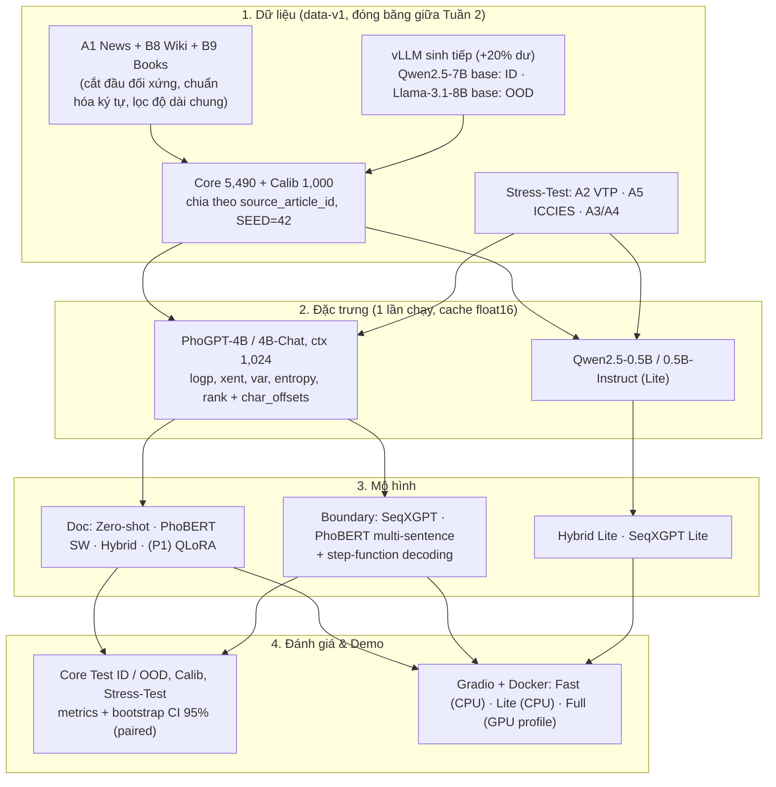

# Kế Hoạch Chi Tiết Thực Hiện Dự Án — v3 (đã rà soát)

**Đề tài:** Phát hiện Văn bản Tiếng Việt do AI sinh ra và Văn bản Lai Người–AI
**Quy mô:** 6 thành viên · 5 tuần + 1 tuần buffer · Kaggle 2×T4
**Nền tảng:** Binoculars (`2401.12070`), VietBinoculars (`2509.26189`), ViDetect (`2405.03206`), SeqXGPT, Fast-DetectGPT; code hiện có: `src/data/preprocess.py`, `src/data/merge_generated.py`, `src/data/text_utils.py`, `scripts/kaggle_vllm_generate.py`.

Bảng thay đổi so với `Detailed_Project_Plan.md` (bản trên `main`) và lý do: xem **Phụ lục A**.

---

## 1. Mục tiêu & Phạm vi

### 1.1. Khoảng trống nghiên cứu
1. VietBinoculars và ViDetect chỉ phân loại **toàn văn bản** (100% Người hoặc 100% AI); thực tế phổ biến là **Người viết mở đầu, AI viết tiếp**.
2. Dữ liệu VietBinoculars cố định prompt = 50 token đầu ⇒ không có văn bản lai với ranh giới thay đổi.
3. Zero-shot khái quát tốt sang LLM mới nhưng yếu với văn bản ngắn/paraphrase; Supervised (PhoBERT) mạnh in-domain nhưng dễ overfit generator.

### 1.2. Đóng góp
1. **Bộ dữ liệu Mixed Human–AI tiếng Việt**: ranh giới ngẫu nhiên theo câu, nhãn từng câu, chia theo bài gốc, có generator OOD, đã kiểm tra shortcut.
2. **Document-level:** Zero-shot vs. PhoBERT vs. **Hybrid** (PhoBERT + đặc trưng xác suất).
3. **Boundary-level:** SeqXGPT-style vs. PhoBERT cửa sổ nhiều câu, cùng **step-function decoding**.
4. **Demo Gradio + Docker**, chạy 1 lệnh, CPU mặc định.

### 1.3. Giới hạn (ghi rõ trong báo cáo)
- Chỉ **một ranh giới Người → AI**. AI→Người, nhiều đoạn xen kẽ, AI sửa từng câu là *future work*.
- Không làm contrastive learning, adversarial training, distillation, ONNX (có trong bản nháp đăng ký). **Tuần 1 xác nhận phạm vi với GVHD.**
- PhoGPT/PhoBERT đã pretrain trên tin tức và Wikipedia tiếng Việt ⇒ có thể "đã thấy" một số bài Người (perplexity thấp, FPR cao hơn ở các miền đó). Báo cáo FPR theo miền và nêu là giới hạn.
- Sailor2 xây trên Qwen2.5; Qwen2.5-7B là generator in-domain ⇒ mọi detector họ Qwen (QLoRA, dự phòng Qwen-1.5B, Lite Qwen-0.5B) có lợi thế in-domain; **chỉ xếp hạng các detector này trên phần OOD.**

### 1.4. Tầng ưu tiên
| Tầng | Nội dung |
|---|---|
| **P0 (bắt buộc)** | Dataset Core + Calib + ST1–ST2; VietBinoculars + Fast-DetectGPT + baseline thống kê; PhoBERT Doc; Hybrid; SeqXGPT boundary; PhoBERT boundary; step-function decoding; metrics + bootstrap; Demo Fast + Docker |
| **P1** | QLoRA `Qwen2.5-1.5B`; ST3 (paraphrase/sampling); Demo Lite; bài toán 3 lớp |
| **P2** | Ensemble câu PhoBERT + SeqXGPT; scale-up PhoBERT 20k mẫu; `xlm-roberta`/`mDeBERTa`; Demo Full (GPU) |

---

## 2. Kiến trúc tổng thể



---

## 3. Dữ liệu

### 3.1. Nguồn (9 bộ, ~7.8 GB, chỉ ở local, tải bằng `dataset_download.py`)
- **A1** `vietnamese-news`: `train` 41,345 cặp Sailor2-8B · `validation` 19,129 cặp Sailor2-8B · `test` 7,222 cặp Gemma-3-12B.
- **A2/A3/A4/B6** họ Vũ Trọng Phụng (cùng 369 đoạn gốc) → **chỉ Stress-Test**.
- **A5** ICCIES 2025 (GPT-4o-mini, Gemini 1.5 Flash, DeepSeek) → **chỉ Stress-Test**.
- **B8** Wikipedia sạch, **B9** Books sạch → bổ sung miền cho Core.
- **B7** Binhvq news: **không dùng** (bỏ khỏi pipeline).
- Ghi giấy phép / điều khoản sử dụng của từng bộ vào báo cáo (phụ lục dữ liệu).

### 3.2. Làm sạch — áp dụng **đồng nhất cho mọi nhãn**
1. **Kiểm tra prompt trong văn bản AI của A1 (Gate G0):** code đọc cột `*-generated_text` cho A1 nhưng cột `*_wo_prompt` cho bộ VTP. Ngày 1–2, kiểm tra 20 dòng: nếu `generated_text` bắt đầu bằng phần đầu của `text` (prompt 50 token) thì cắt prompt theo độ dài ký tự (hoặc dùng cột `_wo_prompt` nếu có), rồi mới bỏ câu cụt đầu. Nếu không, câu Người trong prompt sẽ bị gán nhãn AI.
2. **Cắt đầu đối xứng (chống shortcut vị trí):** văn bản AI của A1 luôn bắt đầu *giữa bài*. Với **mọi văn bản Người rút từ A1** (Human, mồi Mixed, mồi AI-Qwen): bỏ các câu đầu cho tới câu hoàn chỉnh đầu tiên bắt đầu sau mốc 50 token (đo bằng tokenizer Sailor2). B8 Wiki: cùng quy tắc (bỏ câu định nghĩa mở đầu). B9 Books: đã lấy đoạn giữa sách, giữ nguyên.
3. **Chuẩn hóa ký tự:** NFC; quy về một dạng chuẩn cho ngoặc kép/đơn (“ ” ‘ ’ → " '), gạch ngang (– — → -), dấu ba chấm (… → ...), khoảng trắng trước/sau dấu câu, khoảng trắng kép. Áp dụng **trước khi tách câu**, cho mọi nhãn và cả input của demo.
4. **Câu cuối cụt:** bỏ câu cuối không có dấu kết thúc (mọi nhãn).
5. **Một hàm `length_ok()` cho mọi nhãn, chạy sau cùng (sau khi ghép Mixed):** **6–24 câu và 150–650 từ**. Thay các ngưỡng riêng lẻ hiện có (`preprocess.py`: 110–620 từ, ≤ 28 câu; `merge_generated.py`: AI ≥ 3 câu/55 từ, 55–950 từ).
6. **A4:** bỏ dòng lẫn tiếng Mã Lai (tỷ lệ ký tự có dấu tiếng Việt < 5%).
7. **Khử trùng lặp:** chuẩn hóa (lowercase, bỏ dấu câu) + **MinHash 5-gram ký tự, Jaccard ≥ 0.8**, chạy giữa **mọi cặp tập**: Train ↔ Val ↔ Test ↔ Calib ↔ Stress-Test (kể cả A1-train ↔ A1-val/test, vì cùng sự kiện tin tức có thể được viết lại). So khớp 80 ký tự đầu chỉ là bước lọc nhanh.

### 3.3. Tập Core (5,490 mẫu)
Ba lô bài gốc **rời nhau** theo `source_article_id`. Rút **phân tầng theo bin độ dài và miền** (thêm `topic` nếu A1 có cột chủ đề — TV1 kiểm tra ở G0; code hiện chỉ phân tầng theo độ dài), `SEED = 42`.

| Split | Human | AI thuần | Mixed | Tổng |
|---|---|---|---|---|
| **Train** | 1,000 (850 News · 100 Wiki · 50 Books) | 1,000 = 780 Sailor2 (A1 train) + 220 Qwen (160 News · 40 Wiki · 20 Books) | 1,500 Qwen (1,250 · 150 · 100) | **3,500** |
| **Val** | 220 (185 · 20 · 15) | 200 = 150 Sailor2 + 50 Qwen (35 · 10 · 5) | 330 Qwen (280 · 30 · 20) | **750** |
| **Test-ID** | 170 (120 · 30 · 20) | 100 = 70 Sailor2 + 30 Qwen (20 · 5 · 5) | 120 Qwen (95 · 15 · 10) | **390** |
| **Test-OOD** | 150 (110 News A1-test · 25 Wiki · 15 Books) | 300 = 200 Gemma-3-12B (News) + 100 Llama-3.1-8B (70 · 20 · 10) | 400 Llama (330 · 45 · 25) | **850** |
| **Tổng** | **1,540** | **1,600** | **2,350** | **5,490** |

*(Trong ngoặc: News · Wiki · Books.)*
- **Nguồn theo file A1:** Train ← `A1/train`; Val và Test-ID ← `A1/validation` (chia theo dòng 60/40, không chồng lấn — đúng như `mid_val = 0.60` trong code); Test-OOD ← `A1/test`. Wiki/Books chia trước thành 3 pool rời nhau với kích thước cố định: **Wiki 700 / 200 / 300**, **Books 450 / 150 / 200** (train / val / test). Code hiện chỉ quét `part_files[0]` và lấy 900 Wiki / 600 Books ⇒ không đủ cho nhu cầu tập test (Wiki ≈ 217, Books ≈ 135 sau khi tính +20% mồi và Calib); phải quét nhiều file parquet và nâng lên ~1,200 Wiki / ~800 Books **tính sau khi đã cắt đầu và lọc độ dài** (như `scan_*_pool` đang đếm), để các pool 700/200/300 và 450/150/200 luôn đủ.
- **OOD thật sự:** Gemma-3-12B và Llama-3.1-8B **chỉ có ở Test**. Llama có cả AI thuần lẫn Mixed để tách được "generator OOD" khỏi "loại văn bản". OOD Human có Wiki/Books để miền không lộ nhãn.
- **Báo cáo:** tách **ID (390)** và **OOD (850)**; trong OOD báo cáo theo generator × `doc_type`; thêm một dòng **chỉ News** làm kiểm tra.
- **Sinh dư 20%:** số mẫu cần sinh = 300 AI-Qwen + 1,950 Mixed-Qwen + 100 AI-Llama + 400 Mixed-Llama = **2,750**; chuẩn bị **~3,300 mồi** (+20%), sau khi lọc thì rút phân tầng xuống đúng số trong bảng. Báo cáo tỷ lệ bị loại theo generator.

### 3.4. Human Calibration Pool (`subset = calib`, chỉ Người, không phải sinh)
Val chỉ có 220 Người ⇒ ngưỡng 1% FPR dựa trên ~2 mẫu; Test-Core có 320 Người ⇒ TPR@1%FPR dựa trên ~3 mẫu.
- **Val-Calib:** 500 Người (400 News A1-val · 60 Wiki · 40 Books). **Chỉ dùng để chọn ngưỡng 1% FPR**; không dùng cho early stopping hay chọn model (tránh thiên lệch chọn lựa).
- **Test-Calib:** 500 Người (≈ 300 A1-val-tail · 100 A1-test · 60 Wiki · 40 Books). Cùng 320 Người của Core Test ⇒ **820 Người** để đo FPR và TPR@1%FPR.
- Không dùng huấn luyện; không đưa vào F1/Accuracy của Core Test.
- Chi phí: +1,000 bài cho TV2 trích đặc trưng; 0 giờ sinh.
- **Bỏ `TPR@0.06%FPR`** (cần ≥ 1,700 Người cho dù chỉ 1 FP).

### 3.5. Sinh văn bản (TV1, `kaggle_vllm_generate.py` + `merge_generated.py`)
- **Model:** `Qwen/Qwen2.5-7B` (**base**, ID) và Llama-3.1-8B **base** (OOD) qua bản mirror không cần xin quyền `unsloth/Meta-Llama-3.1-8B` (như code; ghi rõ trong báo cáo đây là bản sao trọng số gốc). Dự phòng: `SeaLLMs-v3-7B`.
- **Môi trường:** **pin một phiên bản vLLM đã chạy được trên T4 (sm75)**, kiểm tra ở Gate G2 (bản pip mới có thể thay torch của Kaggle hoặc không hỗ trợ Turing). fp16, `tensor_parallel_size=2`. **Không tự rơi xuống 4-bit:** nếu chỉ có 1 GPU thì script dừng (hoặc ghi trường `quantization` vào từng bản ghi) — hiện code tự bật bitsandbytes 4-bit mà không ghi lại.
- **Tham số (thống nhất theo code):** `temperature=0.7`, `top_p=0.9`, `repetition_penalty=1.08`, `max_tokens = min(700, 1.55 × số từ còn lại + 80)`.
- **Prompt:** $k$ câu Người đã làm sạch, nối bằng dấu cách, **không có dấu cách thừa ở cuối** (sửa `prefix_text + " "` trong code; với BPE, dấu cách cuối làm token đầu tiên bị tách lạ ⇒ artifact đúng tại ranh giới). `lstrip()` phần sinh ra.
- **Điểm cắt Mixed:** bài $N$ câu, $k \sim \mathcal{U}\{\max(2,\lfloor 0.2N\rfloor), \dots, \min(N-2,\lfloor 0.8N\rfloor)\}$.
- **Hậu xử lý phần sinh:** cắt tại `\n\n` đầu tiên hoặc dòng đầu tiên không có dấu kết thúc câu (base model hay viết sang tiêu đề/bài khác); loại mẫu nếu khớp regex `Dưới đây là|Phần tiếp theo|Tin liên quan|Xem thêm|Tags|Bài viết liên quan` hoặc lặp lại câu $s_k$; chuẩn hóa ký tự (3.2.3); bỏ câu cụt cuối.
- **Ghép & gán nhãn:** `full_text = prefix + " " + continuation`. Tách câu **riêng phần continuation**, ghép danh sách $k$ câu Người (nhãn 0) + $M$ câu AI (nhãn 1); kiểm tra `sentence_char_spans` khớp `full_text`. Yêu cầu $M \ge 2$, rồi `length_ok()`.
- **AI thuần (Qwen/Llama):** sinh tiếp từ mồi, **chỉ giữ continuation**, rồi `length_ok()`.
- **QC:** 20 mẫu/model, 2 thành viên chấm (tự nhiên, đúng tiếng Việt, không lặp, không lạc đề); ghi tỷ lệ lỗi.
- **Lưu tiến độ** theo đợt 500 mẫu.

### 3.6. Kiểm tra shortcut (Gate G3a/G3b, trước khi đóng băng `data-v1`)
Mỗi probe là Logistic Regression trên Train, đo AUROC trên Val. **Ngưỡng đạt: AUROC ≤ 0.65.**

| Probe | Đầu vào | So sánh |
|---|---|---|
| Câu đầu | TF-IDF ký tự 2–5 gram của câu đầu | Human vs AI thuần |
| Câu cuối | như trên, câu cuối | Human vs AI thuần; Human vs Mixed |
| Độ dài | số từ, số câu, độ dài câu trung bình | Human vs AI+Mixed |
| Ký tự | tần suất dấu câu/ký tự đặc biệt cả bài | Human vs AI+Mixed |
| Ranh giới | 2 câu quanh $b$ của Mixed vs 2 câu liền kề ở vị trí ngẫu nhiên trong bài Human | — |

Chạy cả 5 probe trên `sample_500` ngay cuối Tuần 1 để phát hiện sớm; quyết định chính thức ở **G3a** (4 probe không cần Mixed, trên `data-v1a`) và **G3b** (probe có Mixed, trên `data-v1`). Kết quả probe đưa vào phụ lục báo cáo.

### 3.7. Stress-Test (chỉ test; ST1–ST2 nằm trong `data-v1`, ST3 phát hành riêng `stress-v1b`)
| # | Bộ | Mục đích | Kích thước |
|---|---|---|---|
| ST1 (P0) | A2 Vũ Trọng Phụng | OOD miền văn học | 738 |
| ST2 (P0) | A5 ICCIES | LLM thương mại, sau MinHash dedup | ~1,000 cân bằng |
| ST3 (P1) | A4 (AI_text → paraphrase_1 → paraphrase_2 → humanized) + A3 (theo nhiệt độ) | Độ bền; đường suy giảm AUROC | ~300–500 |

Chỉ đánh giá Doc-level. Văn bản Người cũng được cắt đầu và chuẩn hóa như 3.2. ST3 là P1 nên được phát hành riêng ở Tuần 3 dưới tên **`stress-v1b`**, không chạm vào dữ liệu Core đã đóng băng; nhờ cache khóa theo hash, TV2/TV6 chỉ trích thêm phần mới (~1 giờ GPU).

### 3.8. Schema (`.jsonl`)
```json
{
  "sample_id": "test_mixed_llama_0012",
  "source_article_id": "news_00142",
  "split": "test",
  "subset": "core",
  "is_ood_generator": true,
  "domain": "news",
  "doc_label": 1,
  "doc_type": "mixed_human_ai",
  "generator": "meta-llama/Llama-3.1-8B",
  "gen_config": {"repo": "unsloth/Meta-Llama-3.1-8B", "dtype": "fp16", "temperature": 0.7, "top_p": 0.9},
  "boundary_sentence_idx": 4,
  "full_text": "Câu 1. Câu 2. Câu 3. Câu 4. Câu 5 do AI. Câu 6 do AI.",
  "sentences": ["Câu 1.", "Câu 2.", "Câu 3.", "Câu 4.", "Câu 5 do AI.", "Câu 6 do AI."],
  "sentence_char_spans": [[0,6],[7,13],[14,20],[21,27],[28,40],[41,53]],
  "sentence_labels": [0,0,0,0,1,1]
}
```
**Quy ước ranh giới duy nhất:** `boundary_sentence_idx` = $b \in \{0,\dots,N\}$ = chỉ số 0-based của câu AI đầu tiên; **$b=0$ ⇒ 100% AI, $b=N$ ⇒ 100% Người** (bỏ `-1`; sửa cả `make_ready_record` trong `preprocess.py` lẫn `validate_all_splits` trong `merge_generated.py`). Bất biến: `sentence_labels[i] == int(i >= b)`. `subset` ∈ {`core`, `calib`, `stress`}.
**Nhãn Doc:** nhị phân *human (0) vs ai + mixed (1)*; báo cáo thêm theo từng `doc_type`.

---

## 4. Tính toán, lưu trữ, cổng quyết định

### 4.1. Ước lượng GPU (Kaggle 2×T4, ~30 giờ/tuần/tài khoản × 6)
| Tác vụ | Ai | Ước lượng (đo lại ở G1/G2) |
|---|---|---|
| Sinh ~3,300 continuation (vLLM fp16, TP=2) | TV1 (Qwen) + TV4 (Llama) | ~3–5 giờ |
| PhoGPT-4B + 4B-Chat, ~8,800 bài (Core 5,490 + Calib 1,000 + ST ~2,300), ctx 1,024, mỗi model 1 GPU | TV2 + TV6 | ~6–8 giờ, chia 2 tài khoản |
| Cặp Qwen2.5-0.5B, cùng tập | TV2 | ~1 giờ |
| PhoBERT Doc / Boundary | TV3, TV5 | ~1–2 giờ/lần × 3 seed |
| QLoRA Qwen2.5-1.5B (P1) | TV2 | ~3–4 giờ |
| Hybrid end-to-end (fine-tune PhoBERT + $f_{stat}$, 3 seed) | TV3 | ~1–2 giờ/lần, 1 T4 |
| SeqXGPT, decoding | TV4 | CPU / 1 T4 |

**Ngân sách GPU theo tài khoản (giờ, cả dự án):** TV1 ~6 (sinh Qwen) · TV4 ~4 (sinh Llama) · TV2 ~8 (trích ½ + Qwen-0.5B) + ~4 (QLoRA) · TV6 ~5 (trích ½) · TV3 ~8 (PhoBERT Doc + Hybrid, 3 seed) · TV5 ~6 (PhoBERT Boundary, 3 seed). Không tài khoản nào vượt 30 giờ/tuần.

**Lưu ý kỹ thuật PhoGPT:** chung tokenizer (kiểm tra vocab giống hệt); PhoGPT (kiến trúc MPT) thường chạy bf16 nhưng T4 chỉ có fp16 ⇒ ở G1 kiểm tra NaN/overflow trong logits và so điểm fp16 với fp32 trên 20 mẫu. Khi 2 model ở 2 GPU, chuyển logits (float32) của observer sang GPU performer theo từng batch, tính xong giải phóng ngay. **Context 1,024 token** (PhoGPT hỗ trợ 8k; ≤ 650 từ ≈ ≤ 1,000 token); báo cáo % bài bị cắt theo nhãn (mục tiêu ≈ 0%).

### 4.2. Cổng quyết định
| Gate | Khi nào | Điều kiện đạt | Nếu không đạt |
|---|---|---|---|
| **G0** | Tuần 1, ngày 2 | Xác định chắc cột AI của A1 có/không chứa prompt; đã xử lý | Chặn mọi bước sau cho tới khi xong |
| **G1** | Cuối Tuần 1 | PhoGPT pair: 100 mẫu không NaN ở fp16; ước lượng toàn bộ ≤ 10 giờ; AUROC VietBinoculars > 0.8 | Chuyển sang cặp `Qwen2.5-1.5B` / `1.5B-Instruct` (nêu rõ chồng họ với generator) |
| **G2** | Cuối Tuần 1 | Phiên bản vLLM đã pin chạy trên T4; 20 mẫu/model đạt QC; throughput đủ xong ≤ 6 giờ | Giảm Mixed còn ~1,200 (Train 750 / Val 170 / Test-ID 80 / Test-OOD 200), giữ tỷ lệ miền; Llama → SeaLLMs-v3 nếu chất lượng kém |
| **G3a** | Tuần 2, ngày 1 (CPU, < 1 giờ) | 4 probe không cần Mixed (câu đầu, câu cuối Human vs AI, độ dài, ký tự) ≤ 0.65 trên `data-v1a`; `validate.py` qua | TV2 chưa trích; sửa làm sạch/lấy mẫu, **tối đa 2 ngày** |
| **G3b** | Giữa Tuần 2 | Probe câu cuối Human vs Mixed và probe ranh giới ≤ 0.65 trên `data-v1` | Sửa hậu xử lý phần sinh, **tối đa 2 ngày**; quá hạn thì đóng băng và nêu kết quả probe là giới hạn |
| **G4** | Cuối Tuần 4 | Chốt model demo | Demo mặc định Mode Fast |

### 4.3. Lưu trữ
| Loại | Nơi lưu | Quy tắc |
|---|---|---|
| `datasets/` thô | Local TV1 (gitignored) | Không upload lại |
| Code, plan, `data/sample_debug.jsonl` | GitHub | Không commit file > 10 MB |
| `processed/`, `calib/`, `stress_test/`, `features_cache/` (1 file/split, float16), `weights/` | HF Organization (**private** đến khi nộp) + Kaggle Dataset | Version tag (`data-v1`…); mọi kết quả ghi version dữ liệu + seed + commit |

`data-v1` (gồm Core, Calib **và Stress-Test**) đóng băng giữa Tuần 2 sau G3b; đổi dữ liệu ⇒ tăng version và chạy lại cache.

---

## 5. Phân công

### 5.0. Nguyên tắc chia việc để ít phải chờ nhau
Đường găng tự nhiên của dự án là **dữ liệu (TV1) → đặc trưng (TV2) → mô hình dùng đặc trưng (TV3 Hybrid, TV4)**. Năm quy tắc dưới đây cắt ngắn đường găng này:

1. **Chốt 3 hợp đồng giao diện trong 2 ngày đầu** (ai cũng code theo được mà không cần dữ liệu thật):
   - **C1 – Schema dữ liệu** (3.8): TV1 chốt, kèm `sample_debug.jsonl` ngày 2–3.
   - **C2 – Định dạng cache đặc trưng**: TV2 chốt (tên trường, dtype, cách padding, khóa `sample_id`) và phát hành **cache giả** sinh ngẫu nhiên cho `sample_debug` ngay ngày 3 ⇒ TV3/TV4 viết code đọc cache trước khi có cache thật.
   - **C3 – Định dạng file dự đoán**: mọi model xuất `preds/<model>_<split>.jsonl` với `{sample_id, doc_score, sent_probs[], b_hat}`; TV5 viết `metrics.py` chỉ đọc file này, TV6 dùng cùng định dạng cho demo qua interface `predict(text) -> {doc_score, sent_probs, b_hat}`. ⇒ Đánh giá và demo không phụ thuộc vào việc model nào xong trước.
2. **Phát hành dữ liệu theo đợt** thay vì chờ toàn bộ:
   - `sample_500` (cuối Tuần 1): đủ 3 loại nhãn. Ngay khi QC G2 đạt (ngày 4–5), TV1/TV4 sinh thật **~150 Mixed-Qwen + 30 AI-Qwen + 20 Mixed-Llama** (~15 phút vLLM) từ các mồi đã định sẵn cho Train/Test ⇒ các văn bản này được **dùng lại trong `data-v1`**, không lãng phí và không rò rỉ.
   - **`data-v1a`** (Tuần 2, ngày 1): mọi phần **không cần sinh** — Human 1,540, Sailor2 1,000, Gemma 200, Calib 1,000, Stress-Test ~2,300 (**~6,000 bài**, ≈ 70% khối lượng trích đặc trưng). TV2 chỉ bắt đầu trích sau khi **G3a** đạt.
   - **`data-v1`** (giữa Tuần 2): thêm phần sinh (~2,550 bài còn lại) sau **G3b**; TV2 trích tiếp.
   - Cache khóa bằng `sample_id` + hash văn bản ⇒ nếu G3 buộc sửa dữ liệu, chỉ trích lại phần bị thay đổi.
   - **Chống rò rỉ khi dùng lại văn bản sinh sớm:** `source_article_id` và split của ~200 mẫu sinh trong Tuần 1 được ghi vào `reserved_ids.json`; khi chạy lại `preprocess.py`, các ID này bị loại khỏi mọi lượt rút khác và giữ nguyên split. `validate.py` kiểm tra mỗi `source_article_id` xuất hiện **đúng một lần** trên toàn bộ Core + Calib + Stress.
   - **`sample_500` chỉ gồm bài Train/Val.** Mọi việc debug và chọn siêu tham số chỉ dùng phần train/val; **không ai đọc `test`, `calib`, `stress` trước Tuần 5** (trừ TV6 chạy `validate.py`, vốn không xem nhãn dự đoán).
3. **Dùng song song 4 tài khoản Kaggle ở Tuần 2:** TV1 sinh Qwen, **TV4 sinh Llama** (TV4 vốn phải chờ cache), **TV2 và TV6** mỗi người chạy một nửa phần trích đặc trưng (cùng một notebook, cùng Kaggle Dataset). TV4 sở hữu script sinh (pin vLLM, sửa script) để TV1 không phải gánh.
4. **Chuyển bớt việc khỏi TV1 ở Tuần 1–2:** dựng ST1–ST2 → **TV5**; `validate.py`, MinHash, probe → **TV6** (demo chỉ thực sự cần model từ Tuần 4); script sinh → **TV4**. TV1 chỉ còn: làm sạch, rút mẫu, sinh Qwen, ghép.
5. **Cân bằng tải Tuần 3–4:** người rảnh sau đường găng nhận phần P1: **TV2** làm QLoRA và bản Lite; **TV1** làm `breakdown_plots.py`, ST3 và bài toán 3 lớp. TV3 chỉ giữ PhoBERT Doc + Hybrid; TV5 giữ PhoBERT Boundary + đánh giá.
6. **Model chỉ dùng văn bản không chờ đặc trưng:** PhoBERT Doc (TV3) và PhoBERT Boundary (TV5) chỉ cần `data-v1`, chạy song song với lúc TV2 trích đặc trưng. TV3 làm Hybrid sau khi có cache.

**Bảng bàn giao (ai cần gì, từ ai, khi nào, trong lúc chờ làm gì):**

| Người | Cần | Từ | Có lúc | Trong lúc chờ làm trên |
|---|---|---|---|---|
| TV4 | mồi QC (20 Llama) | TV1 | T1 ngày 4 | pin vLLM, sửa script sinh |
| TV1, TV4 | `prompts_to_generate.jsonl` (Qwen, Llama) | TV1 | T2 ngày 1 | sinh `sample_500` |
| TV2, TV6 | văn bản thật đã qua G3a | TV1, TV5 | `data-v1a` T2 ngày 1 | `sample_500` (G1 đo đạc, kiểm tra công thức) |
| TV3 (PhoBERT Doc) | `data-v1` | TV1 | giữa T2 | phần train/val của `sample_500` và `data-v1a` (debug, chọn siêu tham số) |
| TV3 (Hybrid) | cache thật | TV2 | cuối T2 | cache giả (C2) + PhoBERT Doc |
| TV4 (SeqXGPT) | cache có Mixed | TV2 | cuối T2 | sinh Llama; `smoothing.py`; căn token–câu trên cache `sample_500` (TV2 xuất cuối T1) |
| TV5 | `data-v1` | TV1 | giữa T2 | dựng Stress-Test; `metrics.py` trên file dự đoán giả (C3) |
| TV2 (QLoRA, Lite) | cache Qwen-0.5B, code Hybrid/SeqXGPT | TV2, TV3, TV4 | T3 | ngưỡng zero-shot |
| TV6 | checkpoint | TV3/4/5 | T4 | `validate.py`, probe, trích đặc trưng; demo với model giả theo interface C3 |

### 👤 TV1 — Data Engineer & Mixed-Text Pipeline (đường găng — chỉ giữ việc trên đường găng)
- G0; làm sạch 3.2; rút Core + Calib (3.3, 3.4); sinh **Qwen** và ghép theo 3.5 (Llama do TV4 chạy cùng script).
- Sửa `preprocess.py` / `merge_generated.py` / `text_utils.py`: cắt đầu đối xứng; chuẩn hóa ký tự; `length_ok()` chung; pool Wiki/Books lớn hơn (3.3); mồi AI-Qwen có Wiki/Books; thêm 100 AI-Llama và 40 Người Wiki/Books ở OOD; $b = N$; sinh dư 20%. (Script sinh do TV4 sửa; MinHash dedup do TV6 viết trong `validate.py`.)
- **Tuần 3–4:** `breakdown_plots.py`; **ST3 (P1)**; bài toán 3 lớp (P1); thống kê dữ liệu và phân tích lỗi cho báo cáo.
- **Bàn giao:** C1 + `sample_debug.jsonl` (T1 ngày 2–3); mồi QC cho TV4 (T1 ngày 4); `sample_500.jsonl` có ~200 văn bản sinh thật (cuối T1); `prompts_to_generate.jsonl` cho Qwen và Llama (đầu T2, cùng `data-v1a`); `data-v1a` (đầu T2); `data-v1` (giữa T2); bảng thống kê (nhãn × miền × độ dài × generator, tỷ lệ bị loại).

### 👤 TV2 — Zero-shot & Feature Extraction
- **Quy ước vai trò (theo code chính thức của Binoculars):** observer $M_1$ = `PhoGPT-4B`, performer $M_2$ = `PhoGPT-4B-Chat`.
  $\log\text{PPL}_{M_2}(s) = -\frac{1}{L}\sum_t \log p_{M_2}(x_t \mid x_{<t})$;
  $\log\text{X-PPL}_{M_1,M_2}(s) = -\frac{1}{L}\sum_t \sum_v p_{M_1}(v \mid x_{<t}) \log p_{M_2}(v \mid x_{<t})$;
  $B = \log\text{PPL}_{M_2} / \log\text{X-PPL}_{M_1,M_2}$ (thấp ⇒ AI).
- **Fast-DetectGPT (analytic, cấu hình chuẩn một model):** sampling = scoring = `PhoGPT-4B`. Với $\tilde\mu_t = \sum_v p(v)\log p(v) = -H_t$ và $\tilde\sigma_t^2 = \sum_v p(v)(\log p(v) - \tilde\mu_t)^2$: điểm $= \sum_t(\log p(x_t) - \tilde\mu_t)/\sqrt{\sum_t\tilde\sigma_t^2}$. Như vậy Fast-DetectGPT là baseline độc lập, không trùng với Binoculars (thành phần X-PPL của Binoculars chính là $-\frac1L\sum_t \tilde\mu_t$ khi lấy chéo hai model). **Phải rút gọn ngay khi logits còn trên GPU.**
- Baseline: Likelihood, LogRank, Entropy (tính trên performer $M_2$).
- **Cache mỗi token (không trùng lặp):** `logp_M1`, `logp_M2`, `xent_12` $= -\sum_v p_{M_1}\log p_{M_2}$, `ent_1`, `ent_2` (entropy của $M_1$, $M_2$), `var_1` ($\tilde\sigma_t^2$ của $M_1$), `rank_M2`, `char_offsets`. Float16, 1 file/split; **khóa mỗi bài bằng `sample_id` + hash của `full_text`** ⇒ nếu dữ liệu đổi, `extract_features.py` chỉ trích lại bài có văn bản thay đổi. Kiểm tra: tái tính Binoculars/Fast-DetectGPT từ cache khớp tính trực tiếp (sai số < 1e-2).
- Cùng bộ đặc trưng với cặp `Qwen2.5-0.5B` / `0.5B-Instruct` (Lite).
- **Tuần 3–4 (sau khi xong cache):** **QLoRA (P1)** `Qwen2.5-1.5B`, 4-bit NF4, `r=16, α=32`, xếp hạng trên OOD; **bản Lite (P1)** — Hybrid Lite và SeqXGPT Lite huấn luyện trên cache Qwen-0.5B, dùng lại code của TV3/TV4.
- **Thứ tự trích (để người sau không chờ):** C2 + cache giả (T1 ngày 3) → cache `sample_500` (cuối T1) → `data-v1a` (đầu T2, ~6,000 bài, TV2 + TV6 song song) → phần sinh còn lại của `data-v1` (~2,550 bài, cuối T2) → ST3 (`stress-v1b`, Tuần 3, ~1 giờ). Ghi theo đợt 500 bài; mỗi đợt xong đẩy ngay lên Kaggle Dataset.
- **Ngưỡng:** Youden J và Closest-to-(0,1) trên Val core; **ngưỡng 1% FPR trên Val-Calib**. Đóng băng trước khi chạy Test.

### 👤 TV3 — Supervised Doc-level & Hybrid
- **PhoBERT Doc (P0):** `vinai/phobert-base-v2`, tách từ `pyvi` (cùng công cụ ở train và demo). Sliding window 256 subword, stride 128, tối đa 6 cửa sổ; attention pooling (chuẩn hóa theo số cửa sổ, không để mô hình đếm cửa sổ).
- **Hybrid (P0):** $\hat y = \sigma(\text{MLP}([h_{\text{doc}} \,\|\, f_{\text{stat}}]))$, **huấn luyện end-to-end** (PhoBERT + nhánh $f_{\text{stat}}$ cùng lúc). Không ghép $h_{\text{doc}}$ của một PhoBERT đã fine-tune trên chính Train: trên Train vector đó gần như tách hoàn hảo, MLP sẽ bỏ qua $f_{\text{stat}}$ và ablation bị lệch. $f_{\text{stat}}$ **chỉ gồm đại lượng trung bình theo token** (không phụ thuộc độ dài): điểm Binoculars; Fast-DetectGPT **chuẩn hóa theo độ dài** $\frac{1}{L}\sum_t(\log p - \tilde\mu_t)/\sqrt{\frac1L\sum_t\tilde\sigma_t^2}$; mean/std log-prob theo câu; chênh lệch nửa đầu – nửa sau; độ sụt log-prob lớn nhất giữa hai câu liền kề. **Cấm:** `num_tokens`, `num_sentences`, `char_len` và mọi tổng chưa chia độ dài. Chuẩn hóa bằng thống kê của Train. Ablation: chỉ PhoBERT (= PhoBERT Doc) / chỉ $f_{\text{stat}}$ (LogReg và LightGBM) / Hybrid end-to-end.
- Early stopping & chọn model trên **Val core**; 3 seed, báo cáo mean ± std.

### 👤 TV4 — Boundary SeqXGPT-style & Decoding
- **Tuần 1 (chủ sở hữu script sinh):** pin phiên bản vLLM chạy trên T4; sửa `kaggle_vllm_generate.py` (bỏ dấu cách cuối prompt, cắt tại `\n\n`, không tự rơi 4-bit, ghi `gen_config`); sinh thử 20 mẫu Llama từ mồi QC của TV1 (ngày 4).
- **Tuần 1–2 (trong lúc chờ cache):** chạy sinh **Llama** (AI thuần 100 + Mixed 400, +20%) trên tài khoản Kaggle của mình bằng script sinh (TV4 sở hữu, TV1 dùng chung); viết `smoothing.py` + unit test; viết bộ căn token–câu trên cache `sample_500`.
- Căn token → câu bằng `char_offsets` + `sentence_char_spans` (token vắt qua 2 câu gán cho câu chứa ký tự đầu); unit test trên `sample_debug`.
- Mô hình: đặc trưng token → 1D-CNN → pooling theo câu → BiLSTM 2 lớp → $p_j$; BCE theo câu có mask.
- **`smoothing.py` (dùng chung):** $\hat b = \arg\max_{0\le b\le N}\big(\sum_{j<b}\log(1-p_j) + \sum_{j\ge b}\log p_j\big)$, $O(N)$ bằng prefix sum (kẹp $p_j$ vào $[10^{-6}, 1-10^{-6}]$). Đối chứng: không decoding (ngưỡng 0.5 từng câu).

### 👤 TV5 — Boundary PhoBERT & Evaluation Lead (chủ sở hữu duy nhất `src/evaluation/`)
- **Tuần 1–2:** chốt C3; **dựng ST1–ST2** (3.7) bằng các hàm đã có trong `preprocess.py`, áp cùng làm sạch 3.2, giao vào `data-v1a`; viết `metrics.py` + `bootstrap.py` chạy trên file dự đoán giả.
- **PhoBERT multi-sentence window:** cửa sổ 3–5 câu ≤ 256 subword, stride 1 câu; biểu diễn câu = mean-pool token; câu nằm ở nhiều cửa sổ thì lấy trung bình; → BiLSTM → $p_j$ → `smoothing.py`.
- **Định nghĩa metric (ghi trong docstring + báo cáo):**
  - *Doc:* AUROC; Macro-F1, Accuracy, Balanced Accuracy tại **ngưỡng Youden từ Val** (mọi model, kể cả supervised); TPR@1%FPR với ngưỡng từ Val-Calib, FPR đo trên 820 Người (Test core + Test-Calib); FPR theo miền. Luôn ghi số mẫu mỗi lớp cạnh F1.
  - *Boundary:* Sentence-F1 = **micro-F1 trên mọi câu, lớp dương = AI**, trên toàn Core Test; **MAE và Acc@k ($k\in\{0,1,2\}$) chỉ trên Mixed**; **Pure-doc accuracy** = tỷ lệ bài thuần có $\hat b$ đúng ($N$ cho Người, $0$ cho AI).
  - *Baseline tầm thường:* $\hat b = \text{round}(0.5N)$ và $\hat b = \text{round}(\bar r N)$ với $\bar r$ = trung vị $b/N$ trên Train; *sanity:* huấn luyện với nhãn xáo trộn phải về AUROC ≈ 0.5.
  - *Bootstrap:* 1,000 lần, lấy mẫu lại **theo tài liệu, phân tầng theo lớp**, ngưỡng giữ cố định; so sánh hai model bằng **paired bootstrap** trên cùng các lần lấy mẫu (báo cáo CI của hiệu số).
  - *Breakdown:* độ dài (<250, 250–450, >450 token), miền, generator × `doc_type`, vị trí ranh giới ($b/N$: <0.4, 0.4–0.6, >0.6).
- Chạy đánh giá ST1–ST3.

### 👤 TV6 — MLOps, Data QA & Web Demo
- **Tuần 1–2 (QA dữ liệu, gỡ tải cho TV1):** `src/data/validate.py` (schema, bất biến nhãn câu, span khớp `full_text`, không trùng `source_article_id` giữa split, không có generator OOD trong Train/Val, MinHash giữa mọi cặp tập) và `src/data/probes.py` (5 probe 3.6). Chạy trên `sample_500`, `data-v1a`, rồi `data-v1` ⇒ quyết định G3 cùng TV1.
- **Demo dựng sớm với model giả** theo interface C3, rồi thay model thật khi có checkpoint.
- **Gradio `app/main.py`:** input + mẫu thử; chuẩn hóa ký tự như 3.2.3; **từ chối** nếu < 50 từ hoặc < 3 câu (giải thích lý do); điểm tổng + nhãn (Người / Lai / AI; "Lai" khi Doc = AI và $0<\hat b<N$); `HighlightedText` tô từng câu; "Ranh giới ước lượng: câu X"; **disclaimer luôn hiển thị**: *"Kết quả mang tính xác suất, chỉ để tham khảo sàng lọc, không dùng làm bằng chứng duy nhất để kết luận gian lận."*
- **Chế độ suy luận — mỗi chế độ chỉ dùng model đã train cho đúng bộ đặc trưng của nó:**

  | Chế độ | Model | Yêu cầu | Image |
  |---|---|---|---|
  | **Fast** (mặc định) | PhoBERT Doc + PhoBERT Boundary + decoding | CPU, ~2 GB RAM | CPU (mặc định) |
  | **Lite** (P1) | Hybrid Lite + SeqXGPT Lite (Qwen-0.5B pair) | CPU, ~5 GB RAM (2 model fp32) | CPU |
  | **Full** (P2) | Hybrid + SeqXGPT trên PhoGPT-4B pair | GPU ≥ 24 GB fp16 (8-bit trên GPU ≥ 12 GB chỉ được bật nếu kiểm tra trên Val: AUROC giảm < 0.01 so với đặc trưng fp16) | Compose profile `gpu` (CUDA image riêng) |
  UI ẩn chế độ không khả dụng trên máy hiện tại.
- `scripts/download_weights.py` (`snapshot_download()`; `HF_TOKEN` từ `.env` nếu repo private; không bake weights vào image).
- `Dockerfile` (torch CPU, pyvi) + `docker-compose.yml` (`docker compose up --build` → `http://localhost:7860`; `--profile gpu` cho Full). Pin phiên bản trong `requirements.txt`. Smoke test Mode Fast trên `sample_debug.jsonl`.
- Review `src/evaluation/` (TV5 sở hữu).

---

## 6. Cấu trúc repository
```text
DL_Project/
├── datasets/                     # [gitignored] 9 bộ thô
├── data/sample_debug.jsonl       # [GitHub] ~20 mẫu
├── data/{processed,calib,stress_test,features_cache}/   # [HF / Kaggle]
├── src/
│   ├── data/       preprocess.py · merge_generated.py · text_utils.py · validate.py · probes.py · dataset.py
│   ├── models/     zeroshot.py · doc_classifier.py · boundary_seqxgpt.py · boundary_phobert.py · smoothing.py
│   └── evaluation/ metrics.py · bootstrap.py · breakdown_plots.py
├── scripts/        download_data.py · kaggle_vllm_generate.py · kaggle_generate_notebook.ipynb · extract_features.py · download_weights.py · entrypoint.sh
├── app/            main.py · inference_pipeline.py
├── Dockerfile · docker-compose.yml · requirements.txt · .env.example · README.md
└── dataset_sources.txt
```
Gộp `dataset_download.py` và `scripts/download_data.py` (trùng chức năng) thành `scripts/download_data.py`.

---

## 7. Lộ trình
| Tuần | Milestone | Công việc |
|---|---|---|
| **1** | Hợp đồng giao diện + đo đạc | **Ngày 1–2 (cả nhóm):** xác nhận phạm vi với GVHD, tạo HF Org, chốt C1/C2/C3. **TV1:** G0 (ngày 2), `sample_debug` (ngày 3), mồi QC cho TV4 (ngày 4), sửa `preprocess.py`/`merge_generated.py`, sinh `sample_500` cùng TV4 (ngày 4–5). **TV2:** cache giả (ngày 3), PhoGPT pair 100 mẫu (NaN, thời gian, công thức) → G1, cache `sample_500`. **TV3:** PhoBERT Doc trên `sample_debug`. **TV4:** pin vLLM, sửa script sinh, QC 20 mẫu → G2, `smoothing.py`. **TV5:** `metrics.py` trên dự đoán giả, dựng ST1–ST2. **TV6:** `validate.py` + `probes.py`, chạy probe trên `sample_500`, khung Gradio với model giả + Dockerfile. |
| **2** | `data-v1a` → `data-v1` + cache | **Ngày 1:** TV1 + TV5 giao `data-v1a` (~6,000 bài) + `prompts_to_generate.jsonl`; TV6 chạy **G3a**. **Ngày 1–3:** TV2 + TV6 trích đặc trưng `data-v1a` (2 tài khoản); TV1 sinh Qwen, TV4 sinh Llama song song. **Giữa tuần:** TV1 ghép; TV6 chạy **G3b**; đóng băng `data-v1`. **Cuối tuần:** TV2 + TV6 trích phần sinh; TV2 xuất kết quả zero-shot. **TV3:** PhoBERT Doc trên `data-v1`. **TV5:** PhoBERT Boundary trên `data-v1`. **TV4:** căn token–câu trên cache `sample_500`. |
| **3** | Baseline | **TV2:** ngưỡng (Val, Val-Calib), bắt đầu QLoRA (P1). **TV3:** PhoBERT Doc xong (3 seed), bắt đầu Hybrid end-to-end. **TV4:** SeqXGPT. **TV5:** PhoBERT Boundary xong; đánh giá các model đã có file dự đoán. **TV6:** `inference_pipeline.py` Mode Fast (thay model giả bằng PhoBERT), `download_weights.py`. **TV1:** `breakdown_plots.py`, ST3 (P1) → `stress-v1b`; TV2/TV6 trích đặc trưng ST3. |
| **4** | Hybrid + decoding + chốt demo | **TV3:** Hybrid + ablation. **TV4/TV5:** step-function decoding, trước/sau. **TV2:** QLoRA xong, bản Lite (P1). **TV1:** bài toán 3 lớp (P1), thống kê dữ liệu cho báo cáo. **TV6:** Mode Lite. **G4.** Checkpoint lên HF. |
| **5** | Đánh giá toàn diện | **TV5 (chủ trì) + TV1 + TV2:** Core ID/OOD, Calib, ST1–ST3, breakdown, paired bootstrap, baseline tầm thường. **TV6:** tích hợp demo. Mọi người viết phần báo cáo của mình. |
| **6** | Buffer | Phần trễ; test `docker compose up --build` trên máy CPU sạch; báo cáo, slide, video dự phòng. |

Mọi script nhận đường dẫn dữ liệu qua tham số ⇒ đổi `sample_500` → `data-v1` không cần sửa code.

---

## 8. Rủi ro
| Rủi ro | Dấu hiệu | Phương án |
|---|---|---|
| Văn bản AI A1 còn chứa prompt | G0 | Cắt prompt theo ký tự trước mọi bước |
| PhoGPT chậm / NaN ở fp16 | G1 | Cặp Qwen2.5-1.5B; xếp hạng trên OOD |
| vLLM không chạy trên T4 / sinh chậm | G2 | Pin phiên bản khác; giảm Mixed theo G2; HF `generate` batch làm dự phòng cuối |
| Còn shortcut | G3a / G3b | Sửa dữ liệu trước khi train tiếp |
| Hết giờ GPU | > 70% quota trước Tuần 4 | Cắt P2 → P1; GPU local cho fine-tune nhỏ |
| Thành viên trễ | chậm milestone > 3 ngày | Cắt P2/P1 trước; dùng buffer Tuần 6 |

---

## 9. Checklist nghiệm thu
- [ ] G0–G3b đạt; `data-v1` (Core + Calib + Stress) đóng băng, qua `validate.py`; probe shortcut ≤ 0.65 và có trong phụ lục.
- [ ] Không trùng bài gốc/near-duplicate giữa mọi cặp tập; OOD generator chỉ ở Test; họ VTP chỉ ở Stress-Test.
- [ ] **Doc-level:** Zero-shot (Binoculars, Fast-DetectGPT, Likelihood, LogRank, Entropy) vs. PhoBERT SW vs. Hybrid (+ QLoRA), tách ID / OOD (generator × doc_type), CI 95%, paired bootstrap; ablation Hybrid.
- [ ] **Boundary:** SeqXGPT vs. PhoBERT, trước/sau decoding, so với baseline tầm thường; Sentence-F1, MAE, Acc@k, Pure-doc accuracy.
- [ ] TPR@1%FPR (ngưỡng Val-Calib) và FPR theo miền trên 820 Người.
- [ ] ST1, ST2 (+ ST3).
- [ ] Demo: đủ tính năng + disclaimer; mỗi chế độ đúng model; `docker compose up --build` chạy trên máy CPU sạch.
- [ ] Mọi kết quả ghi version dữ liệu, seed, commit; giới hạn (contamination, chồng họ Qwen, một ranh giới) nêu trong báo cáo.

---

## Phụ lục A. Thay đổi so với plan trên repo (`Detailed_Project_Plan.md`) và lý do

| # | Mục | Plan trên repo | v3 | Lý do |
|---|---|---|---|---|
| 1 | Prompt trong văn bản AI A1 | Không đề cập | Gate G0 kiểm tra và cắt prompt | Code đọc `*-generated_text` cho A1 nhưng `*_wo_prompt` cho VTP; nếu còn prompt, câu Người bị gán nhãn AI |
| 2 | Mở đầu văn bản | Chỉ cắt câu cụt của mẫu AI | Cắt đầu đối xứng cho mọi văn bản Người từ A1/Wiki | AI luôn bắt đầu giữa bài, Người bắt đầu bằng câu mở bài ⇒ mô hình học "vị trí" thay vì "văn phong" |
| 3 | Chuẩn hóa ký tự | Chỉ NFC + bỏ markdown | Chuẩn hóa ngoặc, gạch, ba chấm, khoảng trắng cho mọi nhãn | Báo chí và LLM dùng kiểu dấu khác nhau ⇒ shortcut, nhất là tại ranh giới Mixed |
| 4 | Lọc độ dài | Mỗi script một ngưỡng khác (110–950 từ, 3–28 câu) | Một `length_ok()` chung: 6–24 câu, 150–650 từ | Ngưỡng khác nhau theo nhãn ⇒ shortcut độ dài |
| 5 | Miền theo nhãn | AI thuần chỉ có News; OOD Người chỉ News | Mọi nhãn đều có News/Wiki/Books, kể cả OOD | Miền Wiki/Books chỉ xuất hiện ở lớp dương ⇒ miền lộ nhãn |
| 6 | Generator OOD | Gemma chỉ AI thuần, Llama chỉ Mixed | Thêm 100 AI thuần Llama; báo cáo generator × doc_type | Nếu không, không tách được "OOD generator" khỏi "loại văn bản" |
| 7 | Số mẫu | Bảng ~300 Gemma / ~600 Llama, Người "chia đều" (không khớp code) | Bảng 3.3 khớp code + bổ sung; tổng 5,490 | Plan và code phải dùng cùng một nguồn số liệu |
| 8 | Sinh dư | Sinh đúng số lượng | +20% mồi rồi rút xuống | Hậu xử lý loại mẫu mà không bù ⇒ thiếu mẫu, lệch tỷ lệ |
| 9 | Tham số sinh | Plan: sinh ở 4-bit + Assistant Prefill, Llama gated. Code: fp16 TP=2 nhưng tự rơi 4-bit khi chỉ có 1 GPU, `top_p`/`repetition_penalty` khác plan | Theo code; mirror unsloth; cấm tự rơi 4-bit; pin vLLM | 4-bit đổi phân phối văn bản mà nhãn `generator` không ghi lại; vLLM mới có thể không chạy trên T4 |
| 10 | Prompt & hậu xử lý | Prompt kết thúc bằng dấu cách; không cắt phần lạc đề | Bỏ dấu cách cuối; cắt tại `\n\n`/tiêu đề; thêm regex | Dấu cách cuối tạo artifact token ngay tại ranh giới; base model viết lan sang tiêu đề/bài khác |
| 11 | Kiểm tra shortcut | Không có | 5 probe ở Gate G3a/G3b | Chứng minh mô hình không học mẹo; plan cũ không có cách phát hiện |
| 12 | Calibration FPR | TPR@1%FPR trên ~1.1k test, kèm 0.06% FPR | Thêm 1,000 Người Calib; bỏ 0.06%; bootstrap CI | Với 220–320 Người, 1% FPR chỉ là 2–3 mẫu; 0.06% không đo được |
| 13 | Context PhoGPT | 768 token | 1,024 token | Văn bản 650 từ vượt 768 token; phần bị cắt là đuôi — chính là phần AI của Mixed |
| 14 | Fast-DetectGPT | Tính chéo trên cặp observer/performer; cache trùng | Cấu hình chuẩn một model; cache không trùng | Bản chéo trùng toán học với X-PPL của Binoculars ⇒ không phải baseline độc lập |
| 15 | Đặc trưng Hybrid | Cấm độ dài thô, nhưng dùng điểm Fast-DetectGPT thô | Chỉ dùng đại lượng trung bình theo token | Điểm Fast-DetectGPT thô tăng theo $\sqrt{L}$ ⇒ đưa độ dài vào lại |
| 16 | Quy ước ranh giới | Schema `-1`, công thức decoding $b=N$ | Thống nhất $b\in\{0..N\}$, sửa cả 2 file code | Hai quy ước mâu thuẫn ⇒ lỗi khi tính MAE/decoding |
| 17 | Metrics | Chưa định nghĩa F1 câu, bootstrap, ngưỡng | Định nghĩa đầy đủ; paired bootstrap; baseline tầm thường; sanity nhãn xáo trộn | So sánh model có ý nghĩa thống kê; người chấm cần mốc so sánh |
| 18 | Demo | Mode 2 dùng Qwen-0.5B cho model học trên PhoGPT; ~1 GB RAM | 3 chế độ, mỗi chế độ model riêng; bộ nhớ thực tế; profile GPU | Đặc trưng khác thang đo ⇒ kết quả vô nghĩa; ước lượng RAM cũ sai |
| 19 | Chồng họ model | Chỉ nêu cho QLoRA | Nêu cho mọi detector họ Qwen; xếp hạng trên OOD | Sailor2 và Qwen2.5-7B cùng họ với Qwen detector ⇒ điểm in-domain bị thổi phồng |
| 20 | Ưu tiên & cổng | Mọi hạng mục ngang nhau | P0/P1/P2 + Gate G0–G4 | 6 người / 5 tuần: cần biết cắt gì trước khi trễ |
| 21 | Stress-Test | TV1 dựng ở Tuần 2, chưa cắt đầu/khử trùng đối xứng | TV5 dựng ST1–ST2 ở Tuần 1–2 trong `data-v1a`, cùng quy tắc làm sạch 3.2; ST3 (P1) do TV1 làm ở Tuần 3 dưới tên `stress-v1b` | Văn bản Người trong ST cũng phải cắt đầu đối xứng, nếu không kết quả Stress-Test bị thổi phồng; chuyển việc để giảm tải TV1 |
| 22 | Khử trùng | 80 ký tự đầu, chỉ Stress vs Train/Val | MinHash giữa mọi cặp tập; bỏ B7 | Đã cắt đầu bài nên 80 ký tự đầu vô hiệu; tin tức trùng sự kiện giữa các file A1 |
| 23 | Ngưỡng & chọn model | Cùng dùng Val | Chọn model trên Val core; ngưỡng 1% FPR trên Val-Calib | Tránh thiên lệch chọn lựa |
| 24 | Sở hữu `metrics.py` | Cả TV5 và TV6 | TV5 sở hữu, TV6 review | Tránh hai người cùng sửa một file |
| 25 | Hybrid | MLP trên $[h_{doc} \| f_{stat}]$ (không nói $h_{doc}$ lấy từ đâu) | Huấn luyện end-to-end | $h_{doc}$ từ PhoBERT đã fine-tune trên chính Train gần như tách hoàn hảo ⇒ MLP bỏ qua $f_{stat}$ |
| 26 | Pool Wiki/Books | Không nêu kích thước | 700/200/300 Wiki, 450/150/200 Books; quét nhiều file | Code hiện chỉ có 200 Wiki test trong khi cần ≈ 217 ⇒ `stratified_pick` báo thiếu mẫu |
| 27 | Chia việc & lịch | TV1 ôm toàn bộ dữ liệu (làm sạch, sinh, Stress-Test, kiểm tra); mọi người chờ bộ dữ liệu đầy đủ | 3 hợp đồng giao diện chốt ngày 1–2; dữ liệu phát hành theo đợt (`sample_500` có văn bản sinh thật → `data-v1a` → `data-v1`); G3 tách G3a/G3b; TV4 sở hữu script sinh và sinh Llama, TV5 dựng ST1–ST2, TV6 làm QA dữ liệu và chạy một nửa phần trích đặc trưng; QLoRA/Lite chuyển sang TV2, ST3/3 lớp/biểu đồ sang TV1 | Rút ngắn đường găng TV1 → TV2 → TV3/TV4; mỗi người luôn có việc làm trên dữ liệu thật hoặc giả trong lúc chờ |
| 28 | Kỷ luật tập test | Không quy định | `sample_500` chỉ từ Train/Val; cấm đọc test/calib/stress trước Tuần 5; `reserved_ids.json` | Tránh chọn siêu tham số trên dữ liệu test và rò rỉ bài gốc khi chạy lại tiền xử lý |
